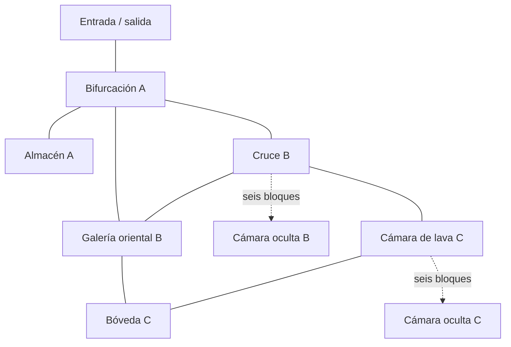

# DIAMOND RUSH — mina subterránea, fase 3 de 6

## Inspección y alcance

Se verificaron la rama `feature/minecraft-minigame`, el estado inicial limpio, los recursos de `assets/models/minigames/minecraft/`, el generador/validador de fase 1, la carga GLB de fase 2 y los módulos compartidos de FPS, raycasting, manifiesto y colisiones. Se abrió el `.blend` de la aldea con Blender 5.4.0 Alpha: escena `Minecraft_Overworld_Village`, 207 objetos, 28 imágenes y escala 1. Sus archivos no se modificaron.

La mina es una escena independiente en `assets/models/minigames/minecraft/mine/`. Se reutilizaron `Batch`, UV y materiales de `build_explorable_village.py` mediante importación, sin ejecutar su generador ni editarlo. El exportador glTF utiliza el mismo workaround local para exportación estática de la distribución Alpha; no cambia la instalación. Se conservan Rust 2021, raylib-rs 5.5.1 y las dependencias existentes.

No se hicieron commits, push, cambios de rama, merges ni rebases. Tampoco se modificaron el planeta esférico, la nave, la aldea, las texturas ni código/configuración/recursos de South Park o del sistema solar.

## Distribución y conectividad

**Nueve cámaras, diez conexiones de túnel y dos circuitos**. La conexión oriental A–B tiene dos tramos en L. Las cámaras miden de 7 a 12 bloques de ancho, los túneles habituales 3–4 y los pasos ocultos 2. La altura libre va de 3 a 6 bloques. Todos los recorridos comparten la cota de suelo Z=0 para reutilizar el controlador plano existente; los sectores se distinguen por distancia a la entrada, revestimientos, minerales e iluminación. No se implementó descenso vertical.

| Sector | Cámaras | Rasgos |
| --- | --- | --- |
| A — mina superior | Entrada, bifurcación, almacén | Soportes de roble, raíles, cobblestone, carbón/hierro y luz abundante. |
| B — galerías | Cruce central, galería oriental, cámara oculta | Variantes de piedra, bifurcaciones, un circuito y una pared preparada para romperse. |
| C — profundidades | Cámara de lava, bóveda oriental, cámara oculta | Techos más altos, oro/redstone/lapis, dos piscinas y conexión alternativa de regreso. |



El grafo y sus polígonos de túnel están en `graph.nodes` / `graph.edges` del manifiesto. Cada arista condicional enumera `requires_break`. `floor_cells` conserva las 1,100 celdas de suelo y su altura de techo para validar el volumen del jugador. El almacén es un ramal sin salida con recompensa. Los dos circuitos permiten regresar por otra ruta sin pasar por lava ni abrir las cámaras ocultas.

## Minerales, bloqueos y lava

Hay **14 bloques de diamond ore**, cada uno con una futura unidad extraíble; el objetivo de ocho es solo una referencia de diseño y no se cuenta en ejecución.

| Cámara | Diamantes | Acceso actual |
| --- | ---: | --- |
| Bifurcación A | 1 | Libre |
| Almacén A | 1 | Libre |
| Cruce B | 2 | Libre |
| Galería oriental B | 1 | Libre |
| Cámara oculta B | 2 | Tras bloqueo |
| Cámara de lava C | 3 | Libre por rutas seguras |
| Bóveda C | 2 | Libre por rutas seguras |
| Cámara oculta C | 2 | Tras bloqueo |

Distribución por sector: **A: 2, B: 5, C: 7**. Diez son accesibles con la mina intacta evitando las dos piscinas. Los cuatro ocultos quedan preparados para fases futuras. También se colocaron **60 bloques decorativos** de mineral: 14 carbón, 14 hierro, 10 oro, 12 redstone y 10 lapislázuli. Estos se integran en la malla estática; no tienen recompensas ni extracción habilitada.

Hay **12 bloques rompibles individuales** repartidos en dos tabiques de 2 × 3: `B_gate` y `C_gate`. Sus IDs `BREAK_*`, mallas, colliders, posiciones y estados iniciales/restauración están separados. Los minerales interactivos usan IDs `ORE_DIAMOND_01` a `14`. Las cajas estáticas se recortan alrededor de los 14 minerales: no queda un collider oculto ocupando el volumen que se retirará. El revestimiento estático conserva caras de fondo para que retirar un bloque en el futuro no exponga el vacío exterior.

Las regiones `Lava_West` y `Lava_Vault` están delimitadas en `lava_regions`, con `damage_enabled: false`. Miden 3 × 5 y 3 × 3 bloques. Hay un suelo sólido debajo durante el desarrollo; la lava puede atravesarse sin consecuencias, pero los validadores la tratan como zona prohibida para demostrar que las rutas seguras bastan. No hay salud, daño, caída o penalizaciones.

## Materiales y luz

Se reutilizaron los PNG verificados de `assets/textures/minigames/Minecraft/`: `stone`, `cobblestone`, `granite`, `diorite`, `andesite`, `gravel`, los seis minerales, `oak_planks`, `oak_log`, `oak_log_top` y `lava_still`. Las 15 primeras imágenes usadas son 16 × 16; la lava original es 16 × 320, con 20 cuadros cuadrados. El primer cuadro superior se extrae únicamente a una imagen en memoria y se empaqueta; el original permanece intacto. La metadata conserva la cantidad de cuadros para una animación posterior, actualmente inactiva.

UV por bloque, caras planas, interpolación `Closest` en Blender y POINT/Nearest en Rust. Los extremos del roble usan su textura específica. No hay atlas borrosos o imágenes estiradas sobre paredes completas. Antorchas/lámparas colgantes, metal y rótulos usan geometría y colores sencillos porque no hay un atlas específico de antorcha en el conjunto inspeccionado.

El `.blend` tiene **20 lámparas** y dos fuentes cálidas de lava, con ambiente tenue. El motor recibe sus 22 posiciones, colores y radios desde el manifiesto. El shader `mine.fs` usa luz puntual con atenuación, emisión de lava/lámparas, niebla oscura y un relleno local tenue alrededor de la cámara. No hay luz diurna dentro de la mina. La iluminación no proyecta sombras en Rust y puede atravesar paredes; Blender usa iluminación de revisión con Cycles. Son aproximaciones distintas y compatibles con el renderizado existente.

## Geometría, colisiones y rendimiento

La cáscara se genera a partir de una distribución finita de cámaras y túneles; se exportan únicamente caras expuestas al interior o a los futuros huecos de minerales. No es un motor voxel ni generación infinita. Suelo, techos y paredes se agrupan por sector. Los 26 bloques preparados conservan seis caras y mallas independientes. Los materiales e imágenes se comparten y se cargan una vez por escena.

La entrega contiene **44 mallas visuales**, **19,704 triángulos**, **20 materiales** y **16 imágenes integradas**. El cargador comparte su implementación con las escenas existentes; para la mina mantiene grupos `ORE_*` / `BREAK_*` al agrupar por material. Se dibujan **45 lotes**, con 26 grupos independientes. `set_group_visible` prepara un cambio de visibilidad sin reconstruir los buffers estáticos; ninguna acción del juego lo invoca en fase 3. Tampoco elimina colliders ni concede minerales.

Se prepararon **153 cajas AABB** más el plano transitable. `CollisionWorld` añade cuatro límites exteriores. Las paredes usan una cobertura rectangular exacta del complemento del suelo; los techos se agrupan por altura y los soportes sólidos tienen cajas propias. Cada bloque preparado tiene su collider con el mismo ID. En el futuro, desactivarlo requiere retirar ese ID y cambiar su grupo visual; el manifiesto conserva el estado inicial para reconstruir/restaurar. No hay lógica de destrucción o reinicio de desafío en esta fase.

## Coordenadas, entrada y salida

Un bloque = una unidad Blender = un metro. Blender usa Z arriba, norte +Y; glTF/raylib usa Y arriba, norte −Z. Conversión compartida `(x,y,z) → (x,z,−y)`, sin escala adicional. Los límites visuales Blender son `(-23,-3,-0.08)` a `(25,59,6)`.

El spawn interior está en `(0,0,1.7)` Blender, mirando +Y, y corresponde a `(0,1.7,0)` raylib. El cuerpo mide 1.8 m, el ojo 1.7 y el radio 0.35, con las mismas velocidades y sensibilidad de fase 2. La salida es el muro señalizado `SALIDA / OVERWORLD` detrás del spawn; su volumen de interacción está delante del muro, con alcance y oclusión compartidos.

`exit` reserva una posición segura de superficie `(8.5,23,1.7)` y orientación `(0,-1,0)` en coordenadas Blender. El futuro desafío podrá usar estas referencias o la pose guardada por `ChallengeRequest` de fase 2. El retorno del modo de desarrollo abre la aldea en su spawn normal; no implementa todavía el retorno de una partida al punto exacto de interacción.

## Probar desde Rust

```powershell
cargo run --bin minecraft -- --mine
```

Se reutilizan `FpsController`, `PlayerInput`, `CursorCapture`, `CollisionWorld`, `SceneManifest` y `select_target` sin cambiar sus archivos. WASD/mouse/Shift exploran. Los minerales y bloqueos muestran una etiqueta al apuntarlos; **E no extrae, destruye ni suma nada**. Frente al letrero de salida, E abre el menú de salida de desarrollo. Backspace lo abre desde cualquier lugar. Escape cancela el menú y retoma la exploración; fuera de menús libera/captura el cursor.

El menú permite **Volver a la aldea** o **Seguir explorando**. Enter también vuelve. El retorno libera recursos, cierra normalmente la ventana de mina y abre la escena de aldea dentro del mismo proceso, sin terminar forzosamente la aplicación. Cerrar la ventana termina el modo de prueba normalmente. F12 guarda una captura; `--capture-dir DIR` cambia la carpeta.

La aldea conserva `cargo run --bin minecraft`; su menú DIAMOND RUSH sigue mostrando el desafío pendiente. South Park conserva `cargo run --bin southpark`; `cargo run` mantiene el menú global y el sistema solar.

## Abrir y regenerar con Blender

Abrir `assets/models/minigames/minecraft/mine/minecraft_mine.blend`. No requiere scripts ni texturas externas. Numpad 0 activa la cámara de entrada; Z → Rendered o F12 permite revisar las luces. Colecciones: `DRM_Static`, `DRM_Interactive`, `DRM_Lava`, `DRM_Colliders`, `DRM_Markers` y `DRM_Presentation`. Los proxies `COL_*` están ocultos en visor/render; desocultarlos desde el Outliner permite revisar sus volúmenes.

Las cámaras `Mine_Camera_entrance`, `galleries`, `depths` y `diamonds` están a altura de jugador. La captura `blender_overview.png` es un corte técnico temporal con techos ocultos y luz aumentada; el archivo guardado siempre conserva sus techos. Para repetir ese corte manualmente, desactivar render de `Shell_*_Ceiling`. No se entrega una mina sin techo.

```powershell
blender --background --factory-startup --python-exit-code 1 --python tools/blender/minecraft/build_underground_mine.py
blender --background --factory-startup --python-exit-code 1 --python tools/blender/minecraft/validate_underground_mine.py
```

Reemplazar `blender` por la ruta al ejecutable local. El generador es determinista y reemplaza únicamente los derivados de la mina y sus capturas Blender. Guardar una copia antes si se hicieron cambios manuales que se quieran conservar. `-- --skip-renders` permite omitir capturas durante ajustes. No se ejecutan generadores históricos de aldea/planeta/nave.

## Verificaciones y límites

El validador de Blender reabre el `.blend`, verifica geometría cúbica, UV, imágenes empaquetadas y Nearest, IDs y colliders individuales sin superposición estática, suelo visual por raycast en todas sus celdas y accesibilidad evitando lava. Comprueba dos estados de datos: bloqueos intactos y apertura hipotética de ambas puertas, sin modificar el archivo ni la escena jugable. Reimporta el GLB y compara mallas, triángulos, materiales, nodos individuales, UV, orientación y límites.

Las siete pruebas nuevas de Rust usan las cajas y el barrido reales para verificar las mismas rutas: **10 diamantes / 7 cámaras** con bloqueos, **14 diamantes / 9 cámaras** con puertas hipotéticamente abiertas. Cubren selección de cada diamante, oclusión, ausencia de extracción con E, colisión de carrera, ausencia de colisiones estáticas ocultas en los bloques y referencia segura para volver a superficie.

`cargo check --offline --locked`, `cargo build --offline --locked` y `cargo test --offline --locked` validan el proyecto completo. Los resultados concretos están en `verification.json`. La prueba gráfica:

```powershell
cargo run --bin minecraft -- --mine --smoke
```

Abre OpenGL real en ventana oculta, usa el mismo bucle de entrada/UI, ejecuta 130 cuadros con eventos de raylib y poses de prueba, comprueba WASD/Shift/mouse, paredes, bloqueos, raycasting sin extracción, pausa del menú, cursor y salida. Después abre y valida la aldea con la prueba de fase 2 en el mismo proceso. Las capturas e informes están en [el índice de fase 3](../references/minecraft/phase3/README.md).

No hubo una partida manual prolongada con teclado/mouse físicos. Las luces de Rust no tienen sombras, el suelo permanece horizontal, la lava es estática y no causa daño, y las cámaras ocultas están cerradas durante esta fase. Sus diamantes no se presentan como accesibles con los bloqueos intactos. Los archivos originales se comparan contra 224 hashes previos; South Park se comprueba con la suite existente y sus modos gráficos de FPS y cinco amenazas, con silencio y sin cambiar sus diagnósticos históricos.

## Archivos y fase 4

Nuevos: los tres recursos y README bajo `assets/models/minigames/minecraft/mine/`; `build_underground_mine.py` y `validate_underground_mine.py`; `src/minigames/minecraft/mine.rs`; `src/scenes/minecraft_mine_dev.rs` y `minecraft_mine_smoke.rs`; `src/graphics/shaders/mine.fs`; `tests/minecraft_mine.rs`; esta guía y las capturas/informes de fase 3.

Modificados: `src/graphics/resources.rs` para luz subterránea y grupos independientes; `src/minigames/minecraft/mod.rs` y `src/scenes/mod.rs` para registrar módulos; `src/scenes/minecraft_dev.rs` para despachar `--mine` y permitir el retorno de desarrollo. Cargo.toml/Cargo.lock y los componentes FPS/colisión/raycasting compartidos no cambian.

Fase 4 dispone de IDs, mallas y colliders separables, enfoques seguros de minerales, estados iniciales para restauración, sensores de lava, referencias de salida y grafo. Falta autorizar e implementar la extracción selectiva, sus efectos y el pico según el alcance siguiente. No se implementaron destrucción efectiva, recolección, inventario, contador de ocho, temporizador, salud, daño, victoria/derrota, música de Diamond Rush o integración solar.
