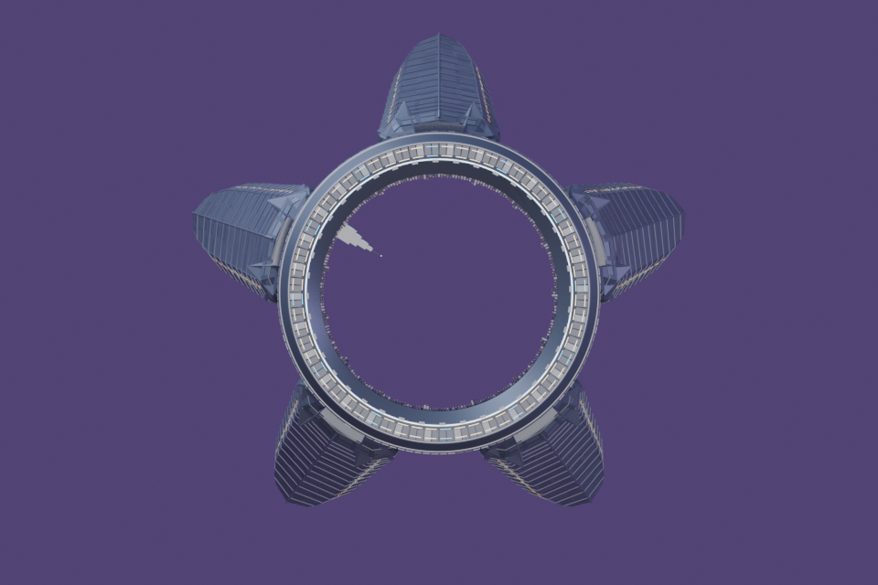
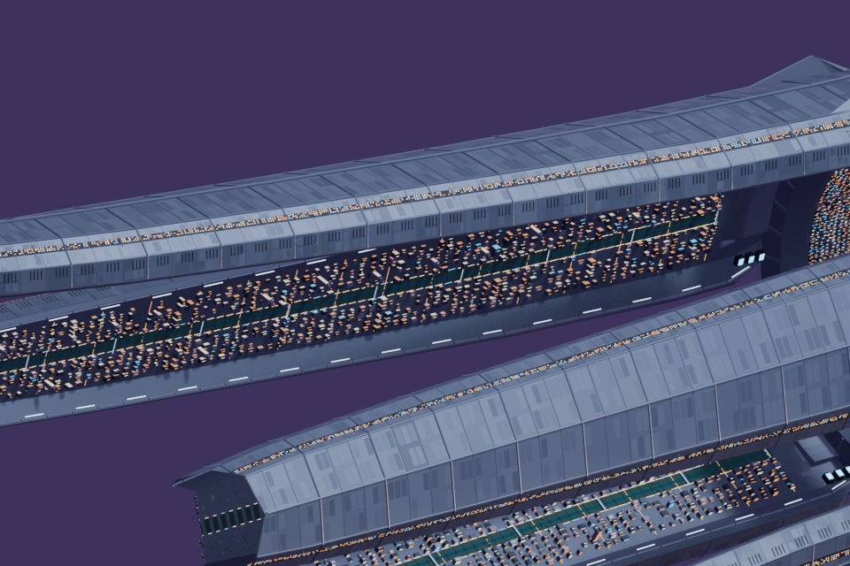
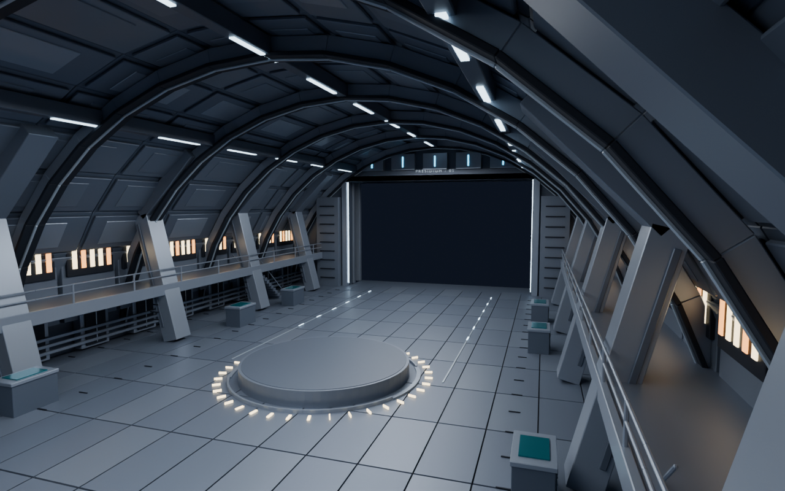
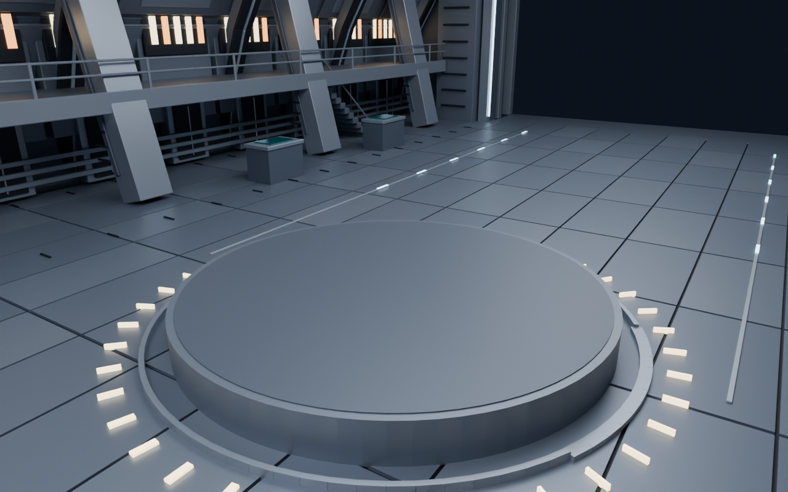
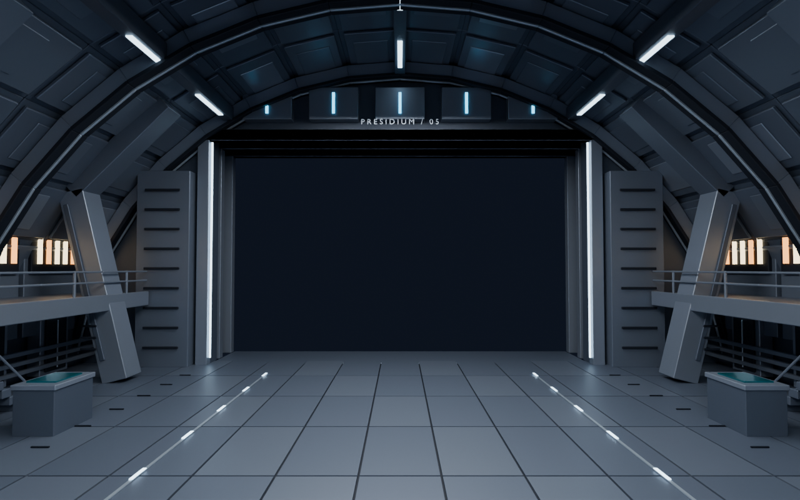
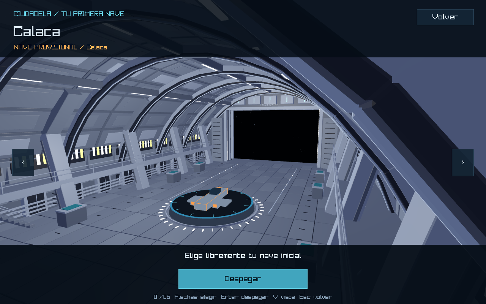
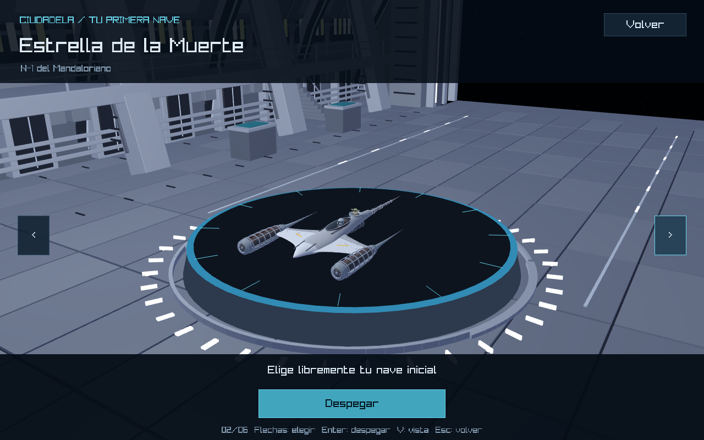
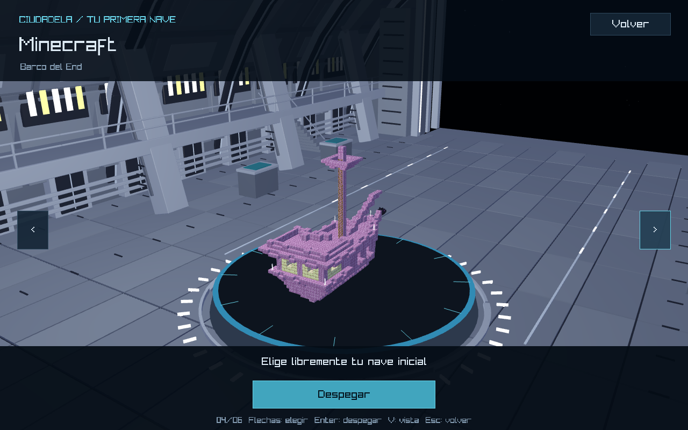
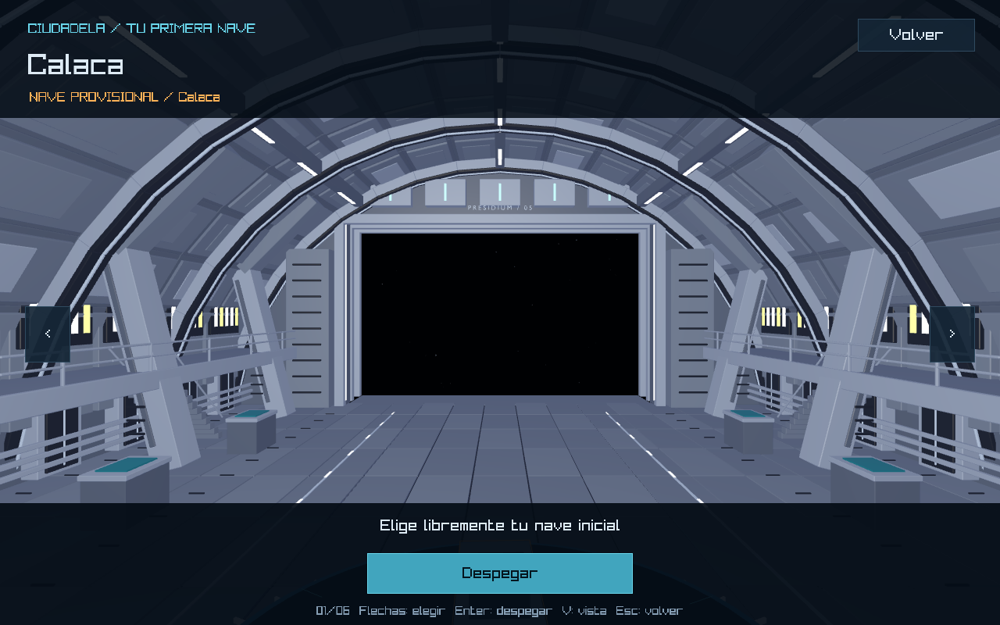

# Hangar del Presidium: revisión visual desde la fuente real

La reconstrucción artística actual está en [Fase 1: arquitectura, materiales y evidencias nuevas](phase1/README.md). El informe siguiente conserva la revisión anterior como referencia; el juego ahora carga `citadel_hangar_phase1.glb`.

Trabajo realizado en `feature/hangar`, sin commit ni push. Los cambios locales del ciclo de estación ya existentes al comenzar se conservaron. Esta revisión modifica únicamente los módulos Rust visuales `src/graphics/hangar.rs` y `src/graphics/hangar_interior.rs`; no cambia `front_end`, selección, vuelo ni minijuegos.

## Fuente e inspección real

Fuente: [`assets/models/environment/spaceStation/citadel_space_station.blend`](../../../assets/models/environment/spaceStation/citadel_space_station.blend).

Se abrió con Blender 5.4 Alpha local, en segundo plano. No fue posible usar Blender MCP porque su addon no estaba conectado. [Inspección de objetos, dimensiones y materiales](source-inspection.json). SHA-256 antes y después: `1791b9c614b915490c205cb1e675b62c09d80f3d0669bbbca2ef185670b29fe9`. El archivo aprobado no se guardó ni modificó.

| Rasgo de la fuente observado en Blender | Derivación en el módulo interior |
| --- | --- |
| `Anillo estructural octogonal`, aros y nervios | Bóveda facetada, ocho marcos transversales de varias capas y quillas longitudinales |
| Blindaje segmentado del Presidium y placas de los brazos | Casetes de techo con juntas, placas secundarias y bordes biselados |
| Cinco acoplamientos y escudos de raíz | Cinco contrafuertes por galería y cinco bloques de acoplamiento sobre la salida |
| Franjas de ventanas, avenidas y balizas | Ventanas cálidas en galerías; luminarias de hielo alojadas en la estructura |
| Titanio azulado, grafito, plata, acero, juntas y canales | Se reutilizan directamente los datablocks de materiales del `.blend`, sin inventar otra paleta |
| Puentes, quillas y volumen habitable interior | Galerías elevadas, escaleras, barandas, puertas de servicio, conductos y consolas |

Es un módulo complementario nuevo, no una habitación extraída del exterior ni una reconstrucción completa de la estación. La bóveda interpreta sus bandas anulares y blindajes para una bahía habitable; sus proporciones conservan la compuerta y dimensiones configuradas (36 × 16 × 56, salida 20 × 12).

## Evidencias de Blender

Los renders siguientes fueron generados abriendo el archivo fuente durante esta revisión:




El módulo nuevo conserva la repetición de placas, nervaduras plateadas, superficies azuladas y franjas cálidas. Añade profundidad física en muros y jambas, una cubierta completa, galerías y servicios.





La plataforma de esos renders es una **referencia de encuadre**, excluida del GLB. La plataforma definitiva la dibuja Rust.

## Plataforma, centrado e integración

Se recuperó del commit local `563f268` la plataforma de radio 4.5, altura 0.8, geometría circular de 64 lados, zócalo escalonado, borde cian y doce marcas radiales. La nave y las marcas giran a 10°/s. Se corrigieron superficies coplanares del diseño para evitar parpadeo.

El cargador compartido existente centra las cajas de los modelos antes de aplicar la escala y orientación del catálogo. El centro horizontal se mantiene en `(0, 0)`; la traslación vertical es `platform_top + half_extents.y`. La rotación se aplica antes de la traslación, sobre el centro ajustado: no describe una órbita. El placeholder conserva su corrección de altura propia. No se modificaron las naves. Se conservó la cámara de exhibición y su encuadre según límites de cada modelo.

Separación efectiva del dibujo:

1. `SpaceModel` arquitectónico: GLB obligatorio, en metros, matriz identidad, sin recentrar ni ajustar su longitud. Un recurso ausente produce un error de carga y no oculta el problema mostrando la sala anterior.
2. `draw_platform`: plataforma original de Rust.
3. `SpaceModel` seleccionado o placeholder: exhibición giratoria.
4. `front_end`: interfaz, selección y acciones existentes, sin modificaciones en esta revisión.

El dibujo procedural de la sala fue eliminado de `hangar_interior.rs`; ese módulo conserva dimensiones de inspección y paleta de plataforma. La abertura está vacía, con umbral y tres jambas sucesivas; raylib dibuja sus estrellas detrás. No es un portal de vuelo continuo.

## Evidencias del juego Rust/raylib

Capturas reales del ejecutable compilado, posteriores a la corrección de superficies de la plataforma:






Otras selecciones: [Calaca provisional](rust-hangar-halloween.png), [Smiling Friends](rust-hangar-smilingfriends.png), [Un Show Más](rust-hangar-regularshow.png), [South Park](rust-hangar-southpark.png). Giro de inspección del mismo modelo: [115°](rust-hangar-smilingfriends-side.png), [205°](rust-hangar-smilingfriends-back.png). [Informe de las seis selecciones](rust-selection-validation.json).

Se revisaron las seis vistas de selección, la bóveda completa y la abertura. Las capturas confirman que el GLB nuevo está siendo renderizado por el juego y que los modelos permanecen dentro de la plataforma. No se atribuyen a raylib las sombras de los renders de Blender.

## Recursos y reproducción

- Editable independiente: `assets/models/environment/spaceStation/citadel_hangar_interior.blend`.
- Exportación: `assets/models/environment/spaceStation/exports/citadel_hangar_interior.glb` (4,169,460 bytes).
- Scripts: `tools/blender/spaceStation/inspect_hangar_reference.py`, `build_hangar.py`, `validate_hangar.py`.
- [Manifest de construcción](build-manifest.json), [validación estructural](export-validation.json), [reimportación real en Blender](export-validation-blender.json).

```powershell
blender -b --python tools/blender/spaceStation/inspect_hangar_reference.py
blender -b --python tools/blender/spaceStation/build_hangar.py
python tools/blender/spaceStation/validate_hangar.py
blender -b --python tools/blender/spaceStation/validate_hangar.py
cargo run --locked
```

El generador abre la fuente y escribe únicamente el derivado y las evidencias. El GLB contiene 11 mallas y 74,748 triángulos; ninguna primitiva excede 17,280 vértices. No contiene cámaras, luces, animaciones ni la plataforma de revisión. Se verificaron ejes, límites, materiales y ausencia de dependencias externas. Los materiales originales son constantes PBR/emisivos: no requieren imágenes de textura. Las texturas existentes de las naves se conservan.

La distribución local Alpha omite un módulo del exportador de animaciones. El script usa el mismo recurso de exportación estática de otras herramientas del repositorio, sin modificar la instalación de Blender. Blender produce avisos de deprecación de `use_nodes`; no impiden la exportación ni los renders.

## Validaciones y límites

- `cargo check --locked`: correcto.
- `cargo build --locked --bins`: correcto, repetido después de corregir la plataforma.
- `cargo test --locked --test station --test ship_selection --test ships --test minigame_returns`: 25 aprobadas.
- `cargo test --locked --no-fail-fast`: 163 aprobadas y una falla previa en `solar_system::la_proximidad_conserva_la_identidad_y_el_minijuego_en_las_nuevas_orbitas`, ya documentada en `docs/station-hangar-cycle.md`; espera `None` aunque Smiling Friends ya devuelve `Some("smilingfriends")`. No se cambió esa prueba ni el minijuego.
- `planet-hoppers --smoke-docking --ship minecraft`: `DOCKING_SMOKE_PASS cycles=3 same_ship=true changed_ship=true cancel=true safe_launch=true`. Conservó nave inicial Minecraft y terminó con Star Wars activa tras cambiarla. Esta prueba se ejecutó antes del ajuste final de alturas coplanares, que afecta solo al dibujo de la plataforma.
- `planet-hoppers --smoke --ship minecraft`: repetido con el dibujo final; `SELECTION_SMOKE_PASS`, `LAUNCH_SMOKE_PASS`, `FRONT_END_SMOKE_PASS`.
- `rustfmt --check` de los dos módulos visuales: correcto. `cargo fmt --check` global conserva diferencias previas, empezando en `src/audio.rs`; no se aplicó un reformateo masivo.
- `git diff --check`: correcto. Se revisaron `git diff`, `git status` y la rama `feature/hangar`. No se modificaron los recursos de naves, planetas ni minijuegos.

Logs completos en `target/hangar-reference.log`, `target/hangar-build.log`, `target/hangar-export-validation.log`, `target/hangar-visual-smoke.log`, `target/hangar-final-smoke.log`, `target/hangar-tests.log` y `target/hangar-format-check.log`.

Pendiente de revisión humana: aprobación de fidelidad y composición visual, controles físicos y fluidez sostenida. En `cargo run --locked`: Jugar, recorrer seis naves, observar el giro varios segundos, pulsar V para alternar exhibición/bahía/salida y Enter para despegar. Desde vuelo, aproximarse a la compuerta, soltar y pulsar E, cambiar nave y volver a despegar; Esc cancela manteniendo la anterior. El recorrido automatizado valida transiciones y estado, no sustituye esa sesión manual.

Limitaciones conocidas: iluminación de raylib mediante el shader existente, sin las sombras de Cycles; vista de exhibición enfocada en la nave y vista V para inspeccionar la cubierta completa; dimensiones del módulo diseñadas para la configuración actual y comprobadas por el validador. Permanecen los avisos previos de índices del exterior de la estación y del planeta Star Wars; el nuevo interior respeta el límite de índices de raylib.
