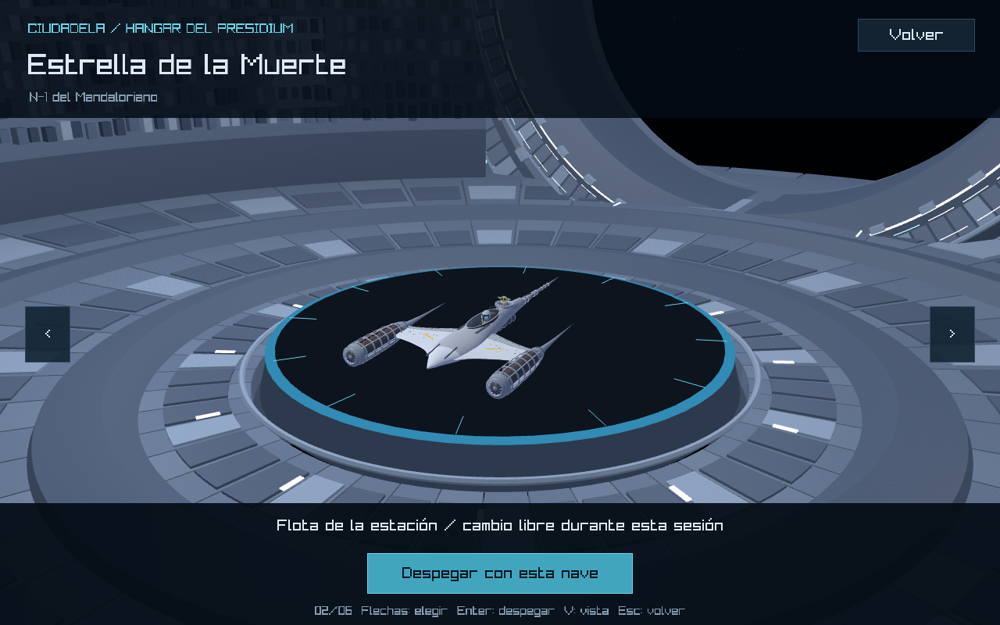
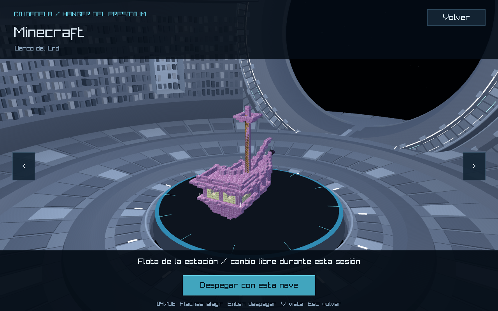
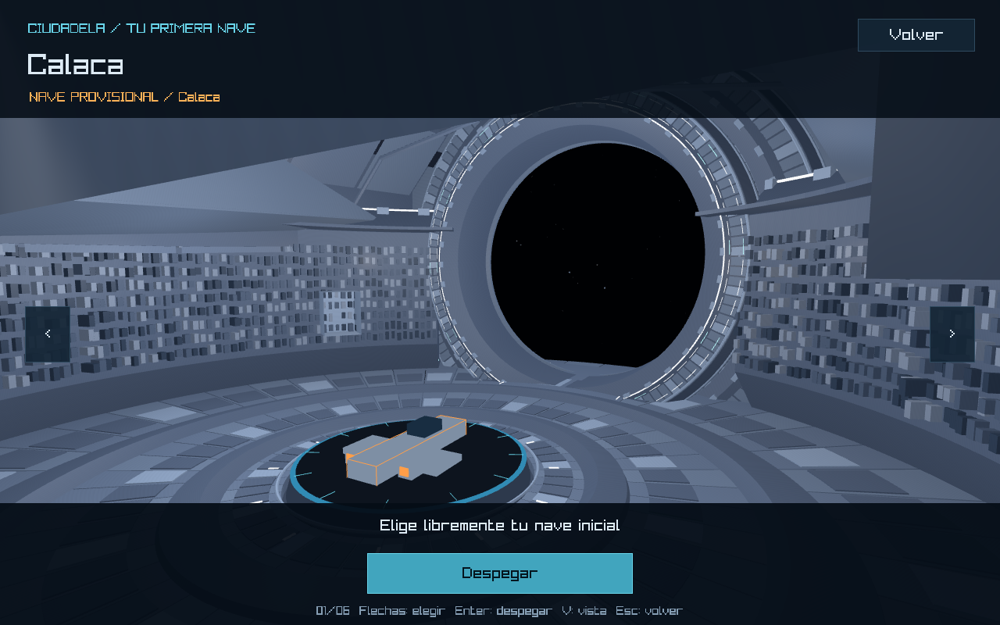

# Fase 2 — integración del hangar aprobado

> Informe histórico de la primera integración. La presentación y exportación actuales se documentan en [la corrección visual posterior](../presentation/README.md); los hashes y capturas de esta carpeta corresponden a la fase 2.

El juego carga **citadel_hangar_reconstructed.glb**, exportado directamente del modelo aprobado **assets/models/environment/spaceStation/citadel_hangar_reconstructed.blend**. El diseño y los bytes del .blend permanecieron intactos. No hubo commit, push ni cambio de rama; se trabajó en feature/hangar.

## Revisión visual en el juego

Ejecutar `cargo run --locked`, entrar a Jugar y recorrer las naves con las flechas. V alterna selección, arquitectura general y salida. Se conservan los botones y sus acciones.

La comparación anterior está en [la captura histórica de fase 1](../phase1/rust-hangar-complete.png). Las imágenes de esta carpeta con prefijo runtime son capturas del framebuffer de raylib, no renders de Blender.

Hay 19 capturas: las seis selecciones, dos ángulos adicionales de Smiling Friends, arquitectura general, salida, entrada y selección durante el atraque, cuatro despegues y tres aproximaciones. [verification.json](verification.json) registra nombres, resolución y SHA-256 de cada imagen.

## Carga y sustitución

- Ruta de carga: assets/models/environment/spaceStation/exports/citadel_hangar_reconstructed.glb.
- HangarStyle::station_model sustituye la ruta citadel_hangar_phase1.glb. El GLB viejo se conserva como archivo histórico y ya no se carga en el hangar.
- Se mantiene SpaceModel::load, el shader exclusivo de arquitectura y una matriz identidad mediante Fit::Same. No se recentra ni ajusta automáticamente el modelo a otra caja.
- La exportación convierte Blender Z-up a glTF/raylib Y-up: (x,y,z) → (x,z,−y). El centro horizontal permanece en el origen y la plataforma conserva su superficie a Y=0.8.
- La caja conservadora del modelo respecto al origen es (26.626122,25.748001,29.763777), sin trasladar la geometría.
- La inspección inicial confirmó que el entorno anterior ya era un GLB único, no una sala procedural activa. Hangar::draw dibuja una sola arquitectura, después la plataforma original y después la nave. No se añadió una segunda sala ni un fallback.
- src/graphics/hangar_interior.rs sigue proporcionando dimensiones heredadas y la paleta de la plataforma; no dibuja arquitectura. La puerta exterior y su contrato de navegación siguen en config/station.json y no se modificaron. El flujo utiliza escenas separadas, sin vuelo continuo a través del portal interior.

## Exportación comprobada

El script tools/blender/spaceStation/export_reconstructed_hangar.py selecciona exclusivamente las cuatro colecciones arquitectónicas 01–04. Exporta 241 objetos, aplica modificadores de espesor y excluye referencias de plataforma/nave, envolvente de seguridad, cámaras, luces y mundo procedural.

El GLB tiene 6,139,568 bytes, 241 nodos y 11 materiales de la estación. No requiere texturas de imagen ni bibliotecas externas. Sus nodos no contienen transformaciones pendientes; las coordenadas están aplicadas. El mayor número de vértices por primitiva es 15,488, dentro del límite de índices de 16 bits de raylib. Se conservan normales y materiales de doble cara.

El script vuelve a importar el GLB y comprueba la reserva cilíndrica de radio 4.8 y altura 6.9 mediante BVH y vértices interiores: cero intersecciones. Esta reserva cubre el radio de base 4.7 y la cota de giro sqrt(18) de cualquier nave ajustada a longitud máxima 6, cuya altura total no puede superar 6.8 desde el suelo.

[export-manifest.json](export-manifest.json) contiene hashes del .blend y GLB, límites espaciales, selecciones y exclusiones. El .blend aprobado conserva el SHA-256 c13b3677c2a8331e8e1803e4d52c4819078124a7b420f3077de4d9bc2d21491a.

Reexportar desde la raíz con Blender en PATH:

~~~powershell
blender --background --factory-startup --python tools/blender/spaceStation/export_reconstructed_hangar.py
~~~

## Corrección necesaria de cámara

La primera integración conservó la cámara existente. En las capturas reales de Minecraft apareció una pieza de la arquitectura atravesando la vista. La auditoría contra las mallas aprobadas detectó obstrucciones en 11 de 18 combinaciones de las seis naves con ventanas 960×640, 1280×800 y 1920×1080. Las distancias antiguas llegaban a superar 24 unidades, atravesando el tambor o la cubierta.

Se mantuvieron el centro de interés, la dirección (0.9,0.6,1.4), el margen 1.08 y las reservas del HUD. Solo se limitó la distancia a 16; cuando la distancia solicitada supera ese límite, el FOV aumenta lo necesario para mantener la misma esfera de encuadre entre las franjas de interfaz. El FOV base sigue siendo 42°. A 1280×800, el cálculo de referencia da aproximadamente 42.33° para el N-1 y 49.48° para Minecraft. La plataforma y la nave no se trasladan ni escalan para resolver el problema.

La auditoría final registra cero obstrucciones al centro y cero a las esquinas de las cajas giradas en cuatro orientaciones para las 18 combinaciones. Los resultados completos están en [camera-obstruction-audit.json](camera-obstruction-audit.json) y [camera-audit.log](camera-audit.log). El script reproducible es tools/blender/spaceStation/audit_hangar_cameras.py.

Las vistas auxiliares de V ahora reproducen las cámaras general y de salida del Blender aprobado. Los puntos anteriores estaban basados en la habitación vieja y una de esas cámaras quedaba dentro de una pared.

## Plataforma, centrado y funcionamiento preservados

Se compararon con HEAD las funciones completas draw_platform, exhibit y update: su texto normalizado permanece idéntico. Sus hashes figuran en verification.json. La plataforma conserva radios, altura, colores y marcas; la nave conserva el ajuste a longitud 6, el centrado X/Z en cero, el apoyo sobre platform_top y el giro de 10°/s.

También permanecen intactos src/scenes/front_end.rs, src/graphics/hangar_interior.rs, src/gameplay/selection.rs, src/scenes/solar_system.rs, config/station.json, config/ships.json y config/ship-selection.json. No se modificaron menú, botones, naves fuente, minijuegos ni planetas.

## Validación ejecutada

| Comprobación | Resultado |
| --- | --- |
| cargo check --locked | PASS |
| cargo build --locked | PASS |
| cargo test --locked --test hangar_asset --test station --test ship_selection --test ships --test minigame_returns | 27 aprobadas, cero fallas |
| target/debug/planet-hoppers.exe --smoke-docking --ship minecraft | Código de salida 0 |
| git diff --check | PASS |

El recorrido gráfico existente utiliza eventos nativos de raylib y las rutas reales de entrada. Se ejecutó sobre el juego compilado con el modelo nuevo y produjo:

~~~text
SELECTION_SMOKE_PASS ... previews=[las seis identidades] ... status=PASS
DOCKING_SMOKE_PASS cycles=3 same_ship=true changed_ship=true cancel=true safe_launch=true active=starwars
FRONT_END_SMOKE_PASS active=starwars initial=minecraft unlocked=2
~~~

La selección inicial recorre las seis naves y comprueba flecha izquierda, regreso al menú y confirmación. En vuelo se hacen tres aproximaciones W/B/E desde fuera de la estación: visita conservando nave, visita cambiando de Minecraft a Star Wars y visita cancelando. Se comprueban la posición/orientación segura de salida, modelos cargados, conservación de sesión solar/órbitas/estado y recarga del hangar. Se verificó que mantener E al salir no abre otra vez el hangar sin liberar la interacción.

El registro completo está en [runtime-docking.log](runtime-docking.log). No hubo HANGAR_MODEL_WARNING ni error de aplicación. El log contiene advertencias de índices de modelos de planetas y estación exterior que ya usan el mecanismo existente rebuild_large_meshes; el hangar exportado no necesita esa reparación.

Las pruebas nuevas verifican exclusión de referencias, GLB autónomo, materiales originales, normales presentes, escala/origen y espacio central. La prueba de encuadre existente ahora usa el FOV efectivo y comprueba el límite de distancia y el objetivo conservado. No se afirma haber ejecutado la suite global completa: se ejecutaron las 27 pruebas pertinentes indicadas.

## Iluminación y límites pendientes

El shader exclusivo hangar.fs usa posiciones de luz convertidas de la presentación aprobada y una base ambiental más legible. No afecta al shader de naves ni al dibujo de la plataforma. Se conservaron los colores, metallic, roughness y emisión de los materiales en el GLB; el cargador existente interpreta KHR_materials_emissive_strength.

Raylib continúa usando el cielo estrellado existente. No se exportaron la nebulosa procedural ni las luces Cycles. El shader de tiempo real aproxima la iluminación y no reproduce exactamente sombras, reflejos ni el BRDF PBR de Cycles. Esto no implicó modificar el diseño aprobado.

La validación de entradas fue automatizada, no con teclado/mouse físicos. Las aproximaciones se preparan fuera de la estación, no simulan un viaje manual completo desde un planeta. Queda la revisión humana de presentación, controles físicos y rendimiento prolongado antes del commit manual.

## Archivos de esta fase

- Modificados: src/graphics/hangar.rs, src/graphics/shaders/hangar.fs, tests/ship_selection.rs y la nota de estado actual en docs/hangar.md.
- Nuevos: exportación GLB, export_reconstructed_hangar.py, audit_hangar_cameras.py, tests/hangar_asset.rs y esta carpeta de documentación/evidencia.
- El .blend aprobado y los archivos de reconstrucción de la fase anterior ya estaban sin seguimiento al iniciar esta fase; se conservaron. Deben incluirse deliberadamente al preparar el commit manual si aún no están versionados.

El resultado está listo para revisión visual. No se hizo commit ni push.
