# Fase 1 — Reconstrucción arquitectónica del Presidium

Esta entrega cambia el entorno artístico y su iluminación local. **No implementa la fase 2 de interfaz.** El árbol ya tenía cambios locales al empezar; se conservaron. Los archivos nuevos de esta fase llevan el sufijo `phase1` para no sobrescribir el interior anterior ni la estación original.

## Fuente de verdad e inspección en Blender

Se abrió realmente `assets/models/environment/spaceStation/citadel_space_station.blend` con Blender 5.4 Alpha local, en segundo plano. Blender MCP no pudo conectarse al addon; no se usaron referencias genéricas como sustituto. Se generaron otra vez los renders del anillo y de los distritos. Después, el validador abrió de nuevo la fuente e inspeccionó objetos, mallas, modificadores, matrices, escala, rotación y entradas de los materiales.

[Inspección completa](source-inspection.json). SHA-256 del original antes/después: `1791b9c614b915490c205cb1e675b62c09d80f3d0669bbbca2ef185670b29fe9`. No se guardó sobre ese archivo.

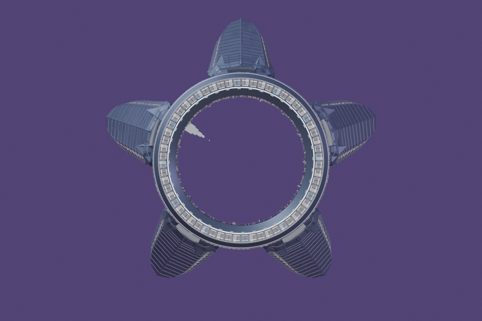
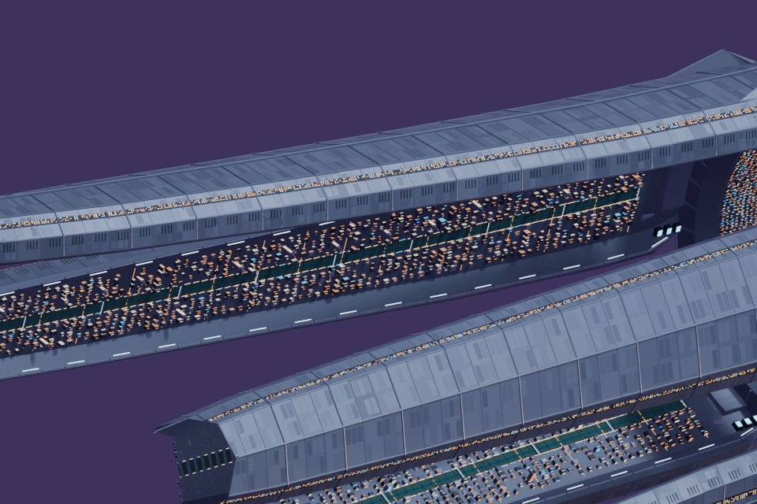

| Rasgo concreto de la fuente | Construcción del nuevo interior |
| --- | --- |
| Anillo estructural octogonal y aros/nervios concéntricos | Bóveda facetada, seis marcos anulares laminados, juntas oscuras y dientes de fijación |
| Placas de blindaje escalonadas de los brazos | Casetes de cubierta superpuestos, registros achaflanados y bordes biselados reales |
| Escudos de raíz y cinco acoplamientos | Cinco sectores de servicio por pared, contrafuertes inclinados y cinco mecanismos sobre la compuerta |
| Rejillas estrechas y nervaduras de los brazos | Radiadores de láminas, intercambiadores de techo, bandejas de cableado y conductos con cambios de dirección |
| Ciudades interiores, puentes y franjas densas de luces pequeñas | Galerías transitables visualmente, escaleras, barandas y pequeños vanos cálidos dentro de cajas oscuras |
| Titanio azulado, acero, plata, grafito, canales y balizas | Datablocks originales reutilizados; variantes derivadas para recesos, metal aceitado y luminarias discretas |

El modelo es un interior complementario, no una sala extraída del exterior. La fidelidad se fundamenta en esas correspondencias y en los materiales reutilizados; **la aceptación artística final corresponde a la revisión humana**, no a una cifra de polígonos.

## Arquitectura y materiales

- **Suelo:** corona de paneles radiales alrededor de la plataforma; canal anular rebajado con rejillas; paneles industriales achaflanados, registros, fijaciones hexagonales y zanjas técnicas laterales. No se cubre la plataforma.
- **Paredes:** cajas mecánicas de varias profundidades, radiadores, armarios eléctricos, accesos de servicio, conducciones y contrafuertes. Los sectores alternan equipamiento en lugar de repetir una única pared lisa.
- **Techo:** cascos y placas secundarios separados por juntas, marcos anulares de varias capas, quillas, intercambiadores y luminarias alojadas en sus soportes.
- **Fondo:** acceso de tránsito industrial con cierre estratificado, maquinaria y puente superior.
- **Salida:** vestíbulo de presión octagonal con cuatro planos de profundidad, juntas, paquetes de compuerta replegados, enlaces hidráulicos, fijaciones, umbral y luces discretas. El centro es un hueco real; no contiene un panel negro.

Se conservan los valores originales de metallic/roughness en los materiales fuente exportados. No hacen falta imágenes externas: la variación nace de geometría, biseles, juntas y materiales. Los indicadores usan copias derivadas de los emisivos originales con menor intensidad, sin bloom ni neón dominante.

El shader local del entorno añade aportes de luminarias de techo, rebote de galería y luz de la salida, más un acabado de mecanizado sutil que se atenúa con la distancia. **No cambia el shader ni la luz de la nave.** El render de raylib sigue siendo una aproximación de iluminación directa; no se presenta como un render PBR completo ni como una reproducción de las sombras de Cycles.

## Evidencias nuevas de Blender

La cámara de composición reproduce el FOV vertical de **42°**, dirección `(0.9, 0.6, 1.4)`, margen `1.08`, distancia mínima `11` y cálculo de encuadre con los márgenes de HUD `151/156`, a 1280×800. Se ajustó al tamaño del N-1 real importado solo como referencia de revisión. La cámara del juego no se modificó.

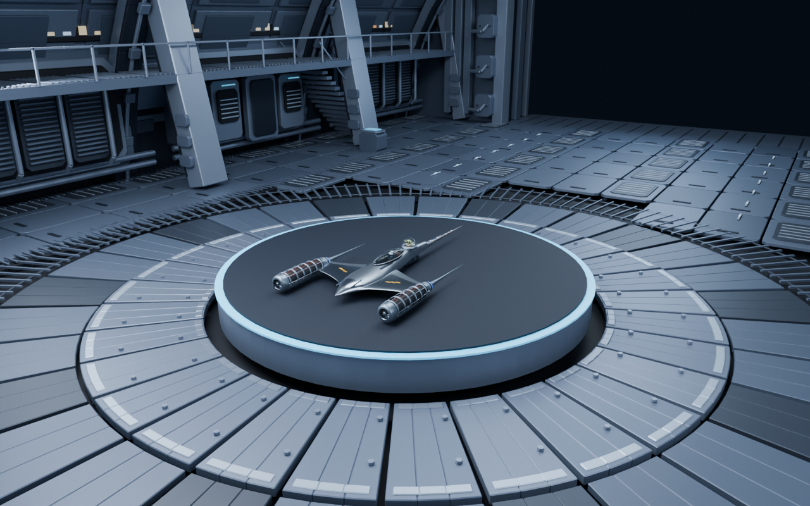
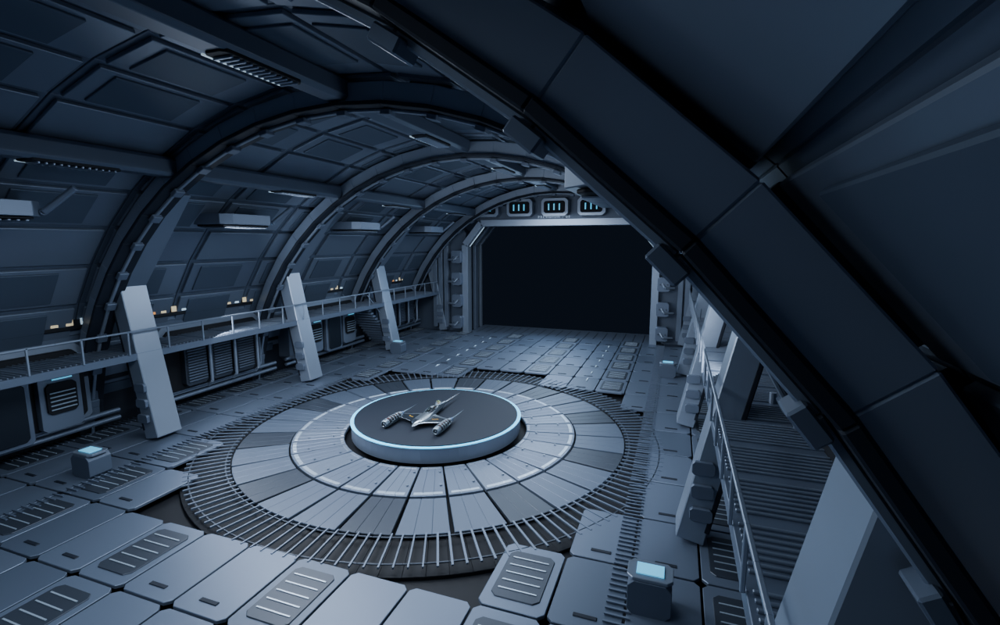
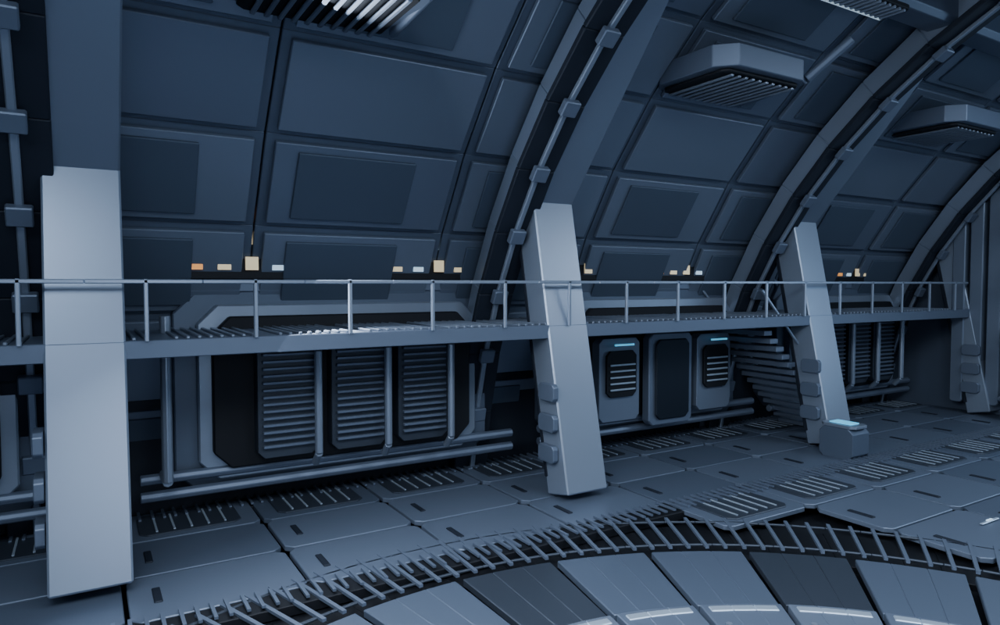
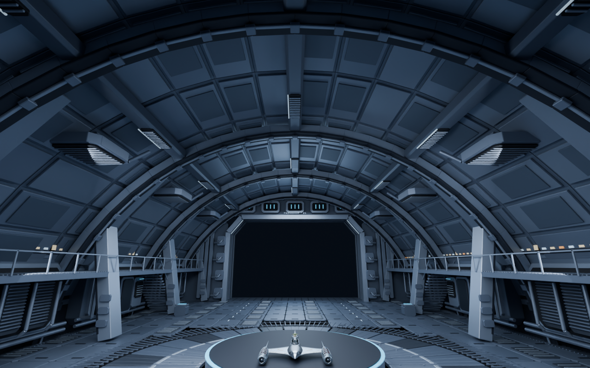
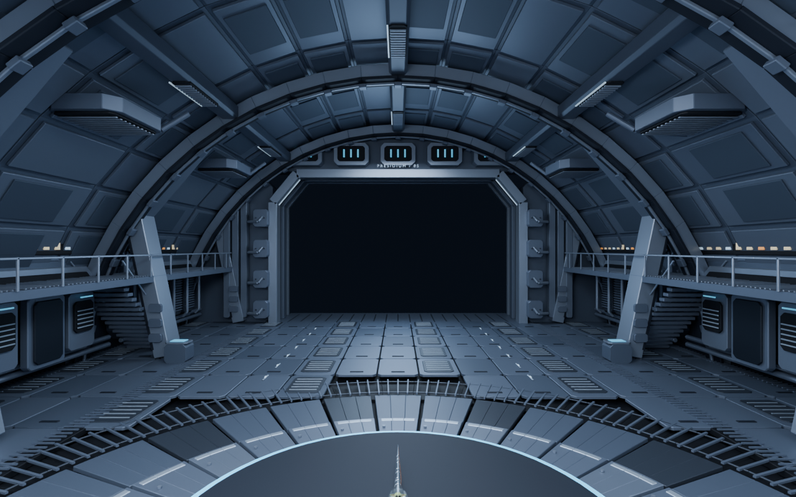
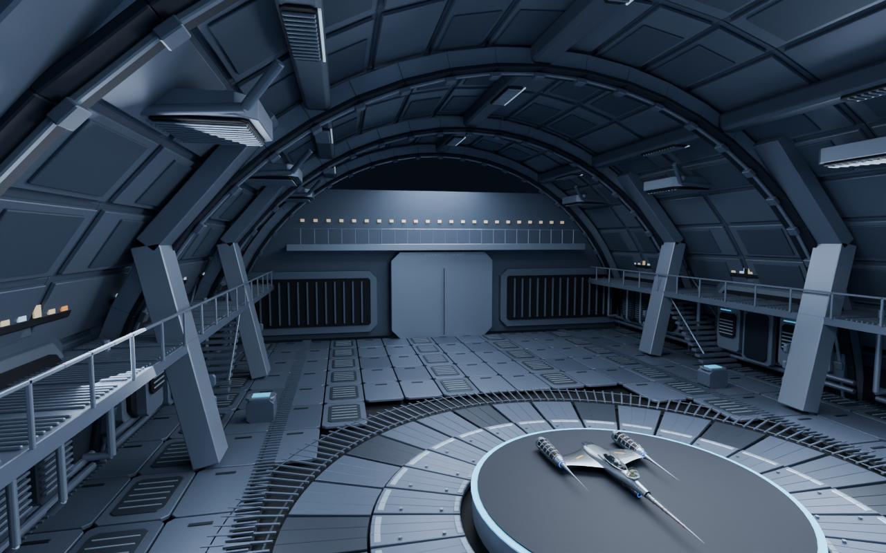

La plataforma y la nave presentes en estos renders son referencias excluidas de la exportación. El GLB únicamente contiene arquitectura; Rust sigue dibujando su plataforma y la nave seleccionada.

## Evidencias reales de Rust/raylib

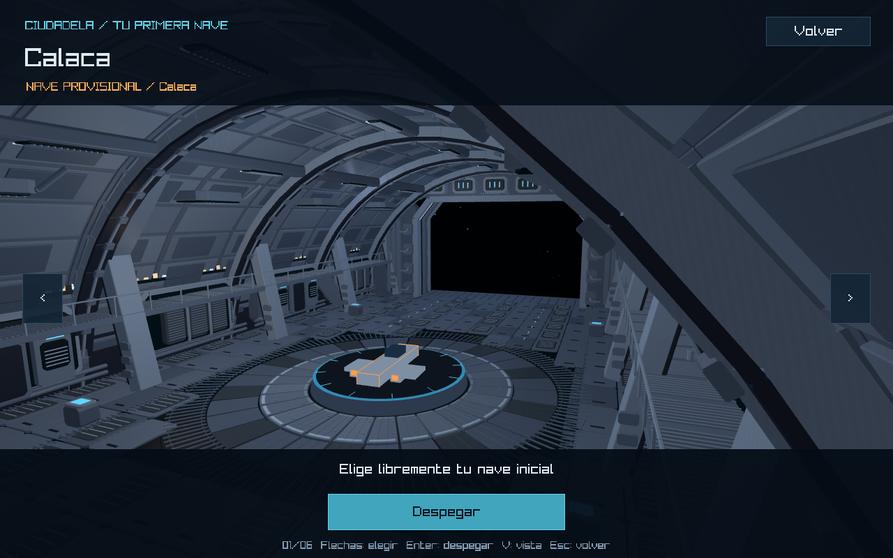
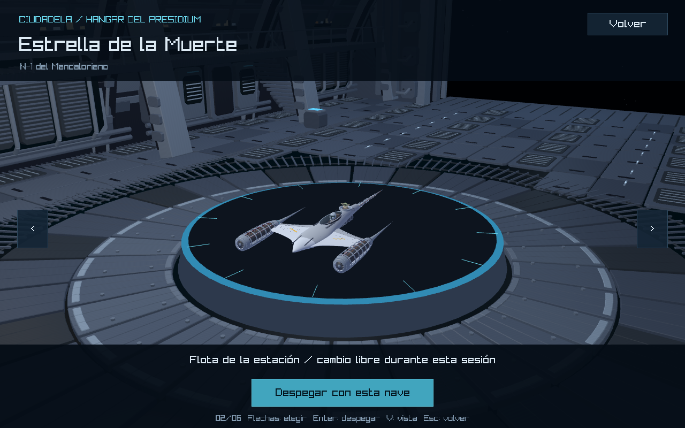
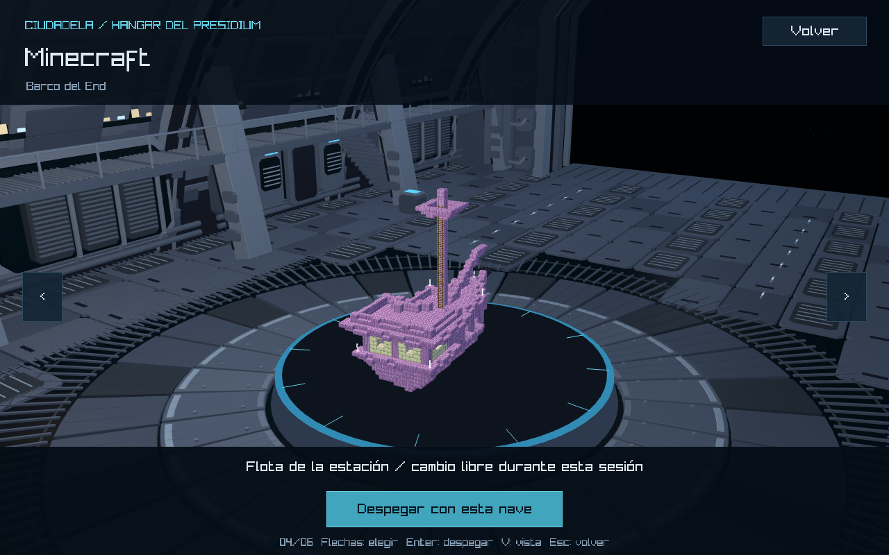
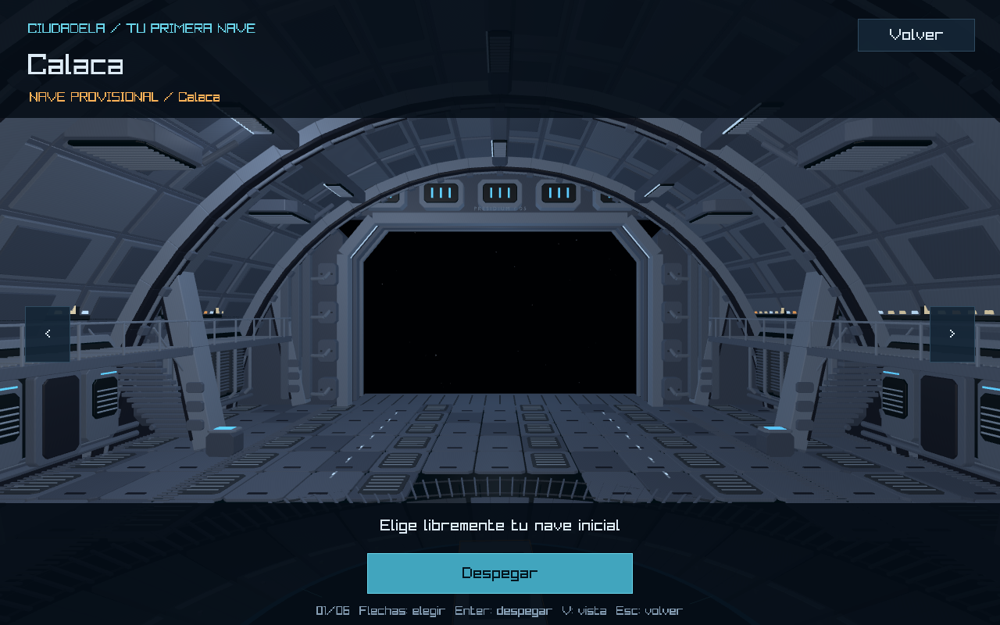

También se revisaron [Calaca](rust-hangar-halloween.png), [Smiling Friends](rust-hangar-smilingfriends.png), [Un Show Más](rust-hangar-regularshow.png) y [South Park](rust-hangar-southpark.png). [Informe de selección](rust-selection-validation.json).

Las imágenes de raylib muestran el acabado real del ejecutable; las de Blender aportan detalle de revisión, no sustituyen la evidencia del juego.

## Componentes congelados

[Comparación contra el estado local al comenzar](protected-components.json). Al revertir únicamente las inserciones del shader ambiental y la ruta del GLB se reconstruye exactamente el hash inicial de `hangar.rs`. Eso verifica que no se tocaron `draw_platform`, geometría/materiales/altura/radio de la plataforma, giro, posición de las naves, centrado, escala de exhibición ni cámara.

Se verificó por hashes que `front_end.rs`, `solar_system.rs`, selección, lógica de estación, configuración de naves/estación y el `.blend` original permanecen iguales al inicio de esta fase. No se rediseñaron botones, paneles ni controles. No se modificaron naves, planetas o minijuegos.

La base conserva radio **4,5**, altura **0,8**, giro **10°/s**, sus tres cuerpos, colores y doce marcas. La corona nueva es parte del suelo arquitectónico y comienza en radio **4,85**, fuera del zócalo de la plataforma; no sustituye ni agranda su geometría funcional.

## Archivos e integración

Nuevos recursos:

- `assets/models/environment/spaceStation/citadel_hangar_phase1.blend`: editable independiente con arquitectura, materiales y colección de revisión separada.
- `assets/models/environment/spaceStation/exports/citadel_hangar_phase1.glb`: arquitectura exportada, **13 598 568 bytes**, **16 mallas**, **78 primitivas**, **241 012 triángulos**, **15 materiales**. Máximo **41 664 vértices por primitiva**, por debajo del límite de índices de raylib.
- `tools/blender/spaceStation/rebuild_hangar_phase1.py`: construcción, exportación y seis renders.
- `tools/blender/spaceStation/validate_hangar_phase1.py`: reapertura, inspección de fuente, reimportación, materiales, normales, huecos y espacio libre.
- `src/graphics/shaders/hangar.fs`: iluminación exclusiva de arquitectura.

Rust modificado en esta fase:

- `src/graphics/hangar.rs`: carga obligatoria del recurso nuevo con matriz identidad y conserva el origen; shader ambiental separado. No se dibuja además el entorno anterior.
- `src/graphics/space.rs`: factoría de carga reutilizada para poder elegir el fragment shader del interior. `SpaceShader::load` conserva el shader anterior para los demás objetos.

No hubo cambios nuevos en `hangar_interior.rs`: ya separaba dimensiones/paleta de la representación artística. Sus parámetros y los de la plataforma quedan congelados. Los cambios de gameplay que aparezcan en `git status` son los que ya estaban presentes al iniciar esta tarea.

## Validación

[Manifest de construcción](build-manifest.json) · [Validación de Blender/GLB](validation.json)

- Original abierto e inspeccionado; hash conservado.
- Editable nuevo cerrado/reabierto correctamente; GLB reimportado en Blender.
- Materiales originales comprobados, sin dependencias de texturas externas.
- Sin caras degeneradas; normales de caras unitarias.
- Sin arquitectura dentro del cilindro reservado de radio 4,75 y altura de exhibición hasta 7,3. Paso útil de salida abierto.
- Plataforma, naves de referencia, luces y cámaras excluidas del GLB.
- `cargo check --locked` y `cargo build --locked --bins`: correctos.
- Suite completa `cargo test --locked --no-fail-fast`: **163 aprobadas y una falla preexistente** en `la_proximidad_conserva_la_identidad_y_el_minijuego_en_las_nuevas_orbitas`: espera `None` para Smiling Friends aunque `main` habilitó su minijuego. No se corrigió una prueba ajena a esta fase.
- Recorrido gráfico `--smoke-docking --ship minecraft`: seis exhibiciones y tres visitas al hangar, con conservación de nave, cambio, cancelación y despegues seguros; `DOCKING_SMOKE_PASS` y `FRONT_END_SMOKE_PASS`.
- Inspección del log confirma carga de `citadel_hangar_phase1.glb`; no se carga el interior anterior en paralelo.
- `git diff --check`: correcto. Se revisó `git status` en `feature/hangar`; sin commit ni push.

Logs: `target/phase1-source-inspection.log`, `target/phase1-build.log`, `target/phase1-validation.log`, `target/phase1-rust-visual.log`, `target/phase1-cycle.log`, `target/phase1-tests.log`.

## Reproducción y límites

```powershell
blender -b --factory-startup --python tools/blender/spaceStation/rebuild_hangar_phase1.py
blender -b --factory-startup --python tools/blender/spaceStation/validate_hangar_phase1.py
cargo run --locked
```

Jugar → seleccionar nave. La vista habitual conserva su encuadre. V alterna las vistas de inspección ya existentes; Enter despega. Desde el espacio, aproximarse a la compuerta y pulsar E para regresar. El interior anterior se conserva como recurso de comparación, pero no se carga.

Pendientes humanos: aprobación de fidelidad artística, observación del giro durante una sesión con entrada física, lectura de detalles en otras pantallas y medición sostenida de FPS. La iluminación del juego no incluye sombras dinámicas ni la iluminación indirecta de Cycles. La geometría está diseñada para las dimensiones actuales de la bahía; si se cambian, se debe regenerar y validar. Los avisos conocidos de índices del exterior/planeta Star Wars no corresponden al GLB nuevo, cuyas primitivas respetan el límite.

**Fase 2 no realizada:** interfaz, menú, botones, paneles y controles permanecen sin cambios de esta fase.
