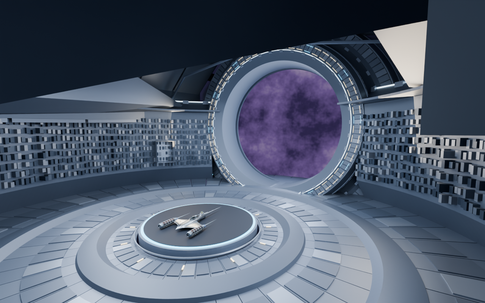
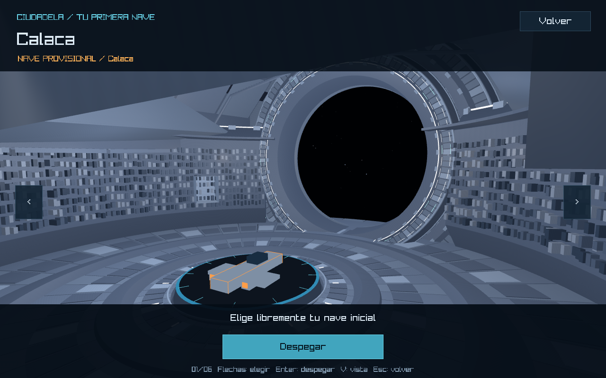
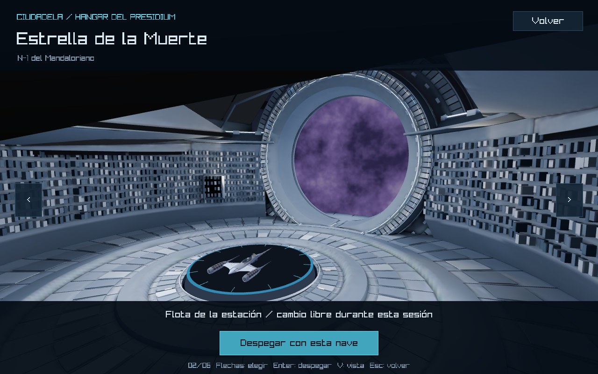
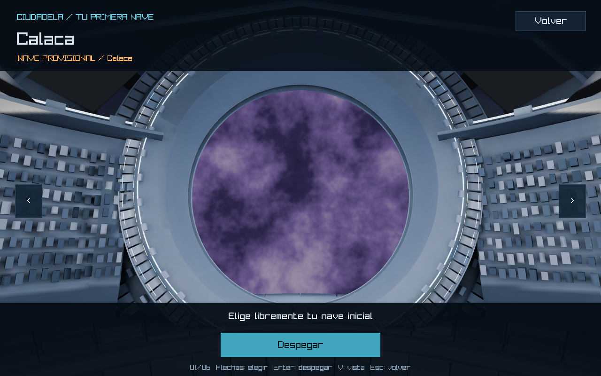
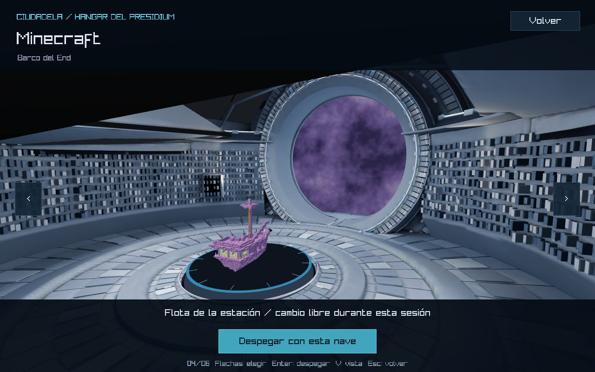

# Presentación del hangar — comparación con Blender

> Ajuste posterior de cámara: acercamiento del 10%, posición (10.8,7.2,12.6), objetivo (0,4.8,−5.5) y FOV base 70°. Las naves ganan aproximadamente un 17–20% de tamaño en pantalla. No cambiaron el entorno, las texturas ni la iluminación. [Captura actual](closer/runtime-hangar-starwars.png) y [verificación del ajuste](closer/verification.json): compilación correcta, 7 pruebas de selección y 18 casos de visibilidad aprobados. La comparación y los valores de cámara que siguen documentan la presentación anterior al acercamiento.

Se corrigió la presentación del modelo aprobado en el juego, sin rediseñar el hangar. El .blend conserva su SHA-256 y las 241 piezas exportadas conservan sus posiciones y triángulos. No hubo commit, push ni cambio de rama: feature/hangar.

## Comparación visual

| Blender aprobado | Integración anterior | Presentación actual |
| --- | --- | --- |
|  |  |  |

Las imágenes runtime son capturas reales del framebuffer de raylib. La columna anterior corresponde a la fase 2 y conserva sus archivos históricos.

## Diferencias encontradas

Los colores PBR y la emisión sí estaban presentes en el GLB; la geometría tenía escala y orientación correctas. La pérdida principal era de presentación: el shader anterior sumaba luces sin oclusión ni las sombras suaves de Cycles, la cámara recortaba la envolvente y el mundo procedural de Blender no formaba parte de la exportación. Por eso la salida quedaba negra y los planos arquitectónicos se confundían.

Al preparar iluminación estática también se detectaron normales invertidas en superficies del suelo. El render de doble cara de Blender y la inversión de normal en el shader anterior las disimulaban. Se corrigieron únicamente en la exportación, después de aplicar los modificadores originales; no se guardó ni modificó el .blend.

## Cámara

La cámara parte de la vista general aprobada: Blender (12,−14,8) mirando a (0,7,6), equivalente en el juego a **posición (12,8,14), objetivo (0,6,−7)**. Esto fija posición, altura, distancia y orientación de la composición al cambiar de nave.

El FOV vertical base es 74°, frente a los 68° del render general de Blender, para dejar espacio a las franjas superior e inferior del HUD. Solo aumenta cuando el tamaño de ventana o de la nave lo exige. El cálculo encuadra un cilindro que contiene todas las orientaciones de la nave y la base de plataforma, sin tratar una nave plana como una esfera alta. Se mantienen los márgenes de 151/156 px y las flechas laterales.

A 1280×800, el N-1, Smiling Friends, Un Show Más y South Park usan 74°; Minecraft aproximadamente 74.17° y Calaca 76.93°. Las vistas auxiliares V conservan la vista general y la salida del modelo aprobado; la general usa también 74° para el HUD.

El script audit_hangar_presentation.py probó seis naves en 960×640, 1280×800 y 1920×1080: cero obstrucciones al centro o a las esquinas de sus cajas en ocho orientaciones, y cero salidas del área útil del HUD. Resultados en [camera-audit.json](camera-audit.json).

## Iluminación, materiales y normales

Se preparó un atlas de radiancia de 4096×4096 con Cycles COMBINED usando las luces, materiales y mundo de la escena aprobada. Incluye iluminación directa e indirecta, sombras arquitectónicas, emisión y el tratamiento de color AgX. No es una captura proyectada de una cámara: son UVs por superficie sobre las mallas reales, que siguen dibujándose en 3D y ocultando correctamente la nave y el fondo.

El atlas se embebe una sola vez como imagen en el GLB. Se preservan los once materiales usados y sus factores originales de color, metallic, roughness y emisión. El shader exclusivo del hangar lee la radiancia ya iluminada sin volver a multiplicar el albedo o sumar emisión y luces, lo que produciría doble color/iluminación. Se añadió filtrado bilineal y margen entre islas UV. Un relleno tenue en las facetas superiores aproxima el rebote metálico que el horneado no conserva completamente al variar la vista.

La exportación conserva nombres de objetos y coordenadas. Se mantuvo la triangulación original de los escudos no planos. [geometry-comparison.json](geometry-comparison.json) compara las 241 piezas contra el GLB previo: cero diferencias en triángulos canónicos, con coordenadas comparadas a precisión de 1e−5. La corrección de orientación de normales y las UVs no alteran las posiciones.

El .blend aprobado mantiene el SHA-256 c13b3677c2a8331e8e1803e4d52c4819078124a7b420f3077de4d9bc2d21491a. Los resultados de preparación están en [bake-manifest.json](bake-manifest.json).

## Fondo espacial

Se renderizó el mundo procedural original a approved_world.png, una panorámica equirectangular de 2048×1024. El nuevo módulo hangar_backdrop.rs reconstruye el rayo de cada píxel según la cámara y su FOV para muestrear esa panorámica; funciona como un fondo espacial orientado, no como un rectángulo pegado a la abertura.

Se dibuja detrás de la arquitectura únicamente en Screen::Hangar. La abertura circular y sus marcos son geometría real que recorta naturalmente el fondo. El menú y el sistema solar conservan su cielo anterior. No se añadieron paredes, marcos o una segunda versión del hangar.

## Conservación del funcionamiento

draw_platform, exhibit y update permanecen idénticos a HEAD: mismos radios, altura, colores, marcas, ajuste de nave a longitud 6, centrado sobre la plataforma y giro de 10°/s. Sus hashes están en [verification.json](verification.json).

La única diferencia en front_end.rs es la rama que dibuja el fondo del hangar. Se verificó que al reemplazar esa rama por el sky.draw anterior el archivo coincide con HEAD; botones, HUD, entrada, selección y flujo no se editaron. Los archivos de selección, sistema solar y configuraciones de estación/naves permanecen intactos. No se modificaron modelos de naves, planetas ni minijuegos.

## Validación ejecutada

| Verificación | Resultado |
| --- | --- |
| cargo check --locked | PASS |
| cargo build --locked | PASS |
| cargo test --locked --test hangar_asset --test ship_selection --test station --test ships --test minigame_returns | 27 aprobadas, cero fallas |
| Auditoría de visibilidad y HUD | 18 combinaciones aprobadas |
| Comparación geométrica con exportación anterior | 241 piezas, cero diferencias de posición/triángulos |
| Recorrido gráfico --smoke-docking --ship minecraft | Código 0; tres visitas completadas |
| git diff --check | PASS |

El recorrido gráfico pasó selección de las seis naves, flecha izquierda, regreso al menú, despegue, aproximación y tres visitas a la estación: conservar nave, cambiarla y cancelar. Conservó la sesión solar y volvió a despegar tras cada visita. El registro [runtime.log](runtime.log) contiene DOCKING_SMOKE_PASS y FRONT_END_SMOKE_PASS, sin HANGAR_MODEL_WARNING ni error de aplicación.

Se guardaron 19 capturas en esta carpeta: seis naves, dos ángulos adicionales de Smiling Friends, vista general, portal, entrada y selección durante atraque, cuatro despegues y tres aproximaciones. verification.json registra sus nombres, resoluciones y hashes.

## Archivos de esta corrección

- src/graphics/hangar.rs: cámara de presentación, carga del fondo y filtrado de la arquitectura.
- src/graphics/hangar_backdrop.rs y shaders/hangar_backdrop.fs: fondo del mundo aprobado; declaración en graphics/mod.rs.
- src/graphics/shaders/hangar.fs y graphics/space.rs: lectura de radiancia estática y filtrado, exclusivamente para el entorno.
- src/scenes/front_end.rs: elección del fondo solo al dibujar el hangar.
- Exportación existente citadel_hangar_reconstructed.glb: UVs, normales corregidas y atlas embebido; misma arquitectura.
- assets/textures/environment/hangar/: atlas reproducible y panorámica espacial.
- tools/blender/spaceStation/prepare_hangar_presentation.py y audit_hangar_presentation.py; el exportador existente delega ahora a la preparación actual.
- Pruebas de recurso/encuadre y documentación.

## Reproducción y límites

Con Blender en PATH, desde la raíz:

~~~powershell
blender --background --factory-startup --python tools/blender/spaceStation/export_reconstructed_hangar.py
blender --background --factory-startup --python tools/blender/spaceStation/audit_hangar_presentation.py
cargo run --locked
~~~

La preparación abre el .blend sin guardarlo; escribe el GLB, atlas y panorámica. El modo --geometry-only del exportador genera exclusivamente un recurso diagnóstico en target y no sustituye la exportación de juego con iluminación.

La iluminación arquitectónica es estática: si cambian luces o arquitectura se debe regenerar el atlas. No se incorporó un renderizador Cycles a raylib; reflejos dependientes de la vista y sombras de las naves dinámicas no se reproducen exactamente. La plataforma y las naves mantienen su renderizador anterior por la restricción de conservarlas.

Los controles se ejercitaron con eventos nativos automatizados, no con teclado/mouse físicos. Las aproximaciones parten desde fuera de la estación y no simulan un viaje manual completo desde un planeta. La evaluación estética final y una sesión prolongada de rendimiento quedan para revisión humana. No se ejecutó la suite global de minijuegos: se ejecutaron las 27 pruebas pertinentes indicadas.

Listo para revisión visual; sin commit ni push.
