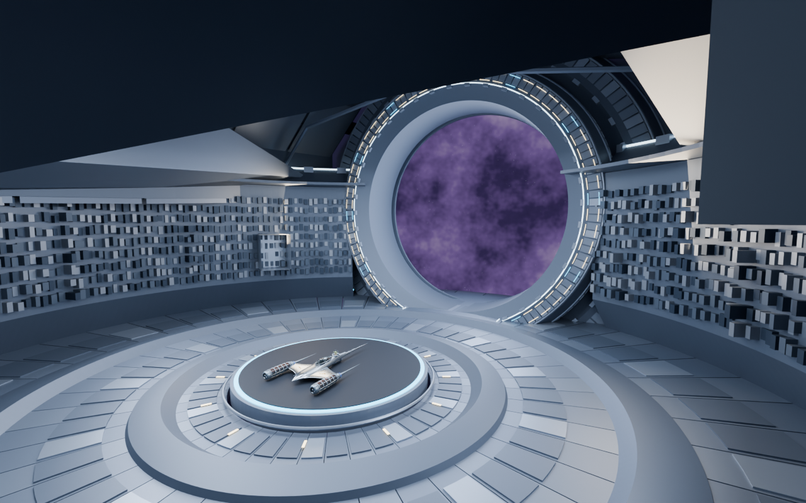
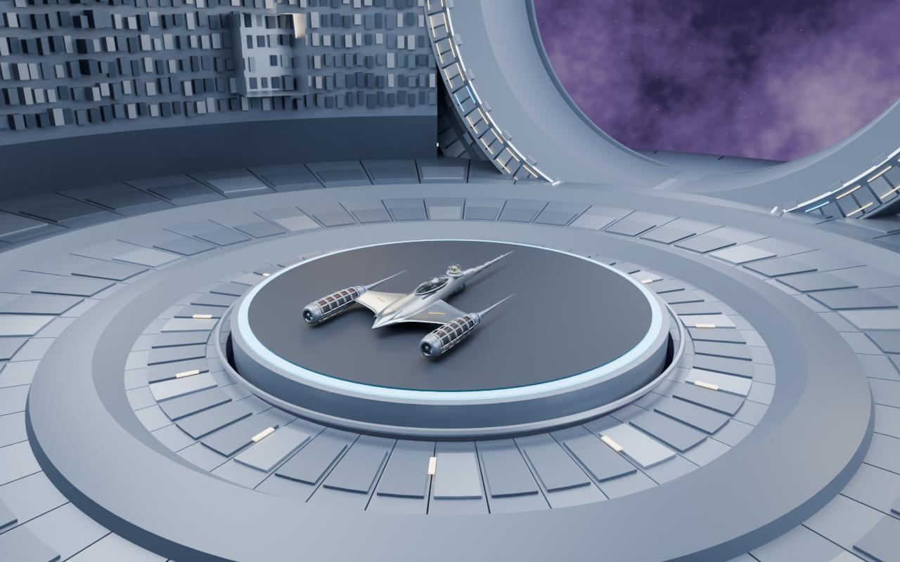

# Hangar reconstruido a partir de la Ciudadela

Modelo independiente para revisión artística. **No está integrado al juego.** Rama de trabajo: feature/hangar. Fecha: 2026-11-02.

## Abrir el modelo

Abrir en Blender **assets/models/environment/spaceStation/citadel_hangar_reconstructed.blend**, escena **HANGAR | Presidium reconstructed**. Fue creado y reabierto con Blender 5.4.0 Alpha. Pulsar Numpad 0 para ver la cámara activa; las otras cinco cámaras están en la colección 92. No se ha comprobado la apertura en versiones anteriores.

El original inspeccionado es **assets/models/environment/spaceStation/citadel_space_station.blend**. Se abrió realmente con Blender MCP y con Blender en segundo plano. No se sobrescribió. Su SHA-256 es 1791b9c614b915490c205cb1e675b62c09d80f3d0669bbbca2ef185670b29fe9.

## Evidencia visual

| Vista | Archivo |
| --- | --- |
| Estación original, perspectiva general | [01-original-general.png](01-original-general.png) |
| Estación original, anillo frontal | [02-original-presidium.png](02-original-presidium.png) |
| Estación original, distritos y brazos | [03-original-districts.png](03-original-districts.png) |
| Nueva cámara equivalente al juego | [04-game-camera.png](04-game-camera.png) |
| Nuevo interior general | [05-interior-general.png](05-interior-general.png) |
| Arquitectura lateral y materiales | [06-lateral.png](06-lateral.png) |
| Cubierta y costillas | [07-roof.png](07-roof.png) |
| Marco físico de salida y espacio exterior | [08-exit.png](08-exit.png) |
| Volumen arquitectónico desde fuera | [09-architecture.png](09-architecture.png) |

Los tres renders del original son de 1440×960; los seis del nuevo modelo son de 1280×800. Todos se renderizaron en Blender con Cycles. Ninguna imagen del hangar anterior se usa como evidencia de esta construcción.

## Qué se encontró y cómo cambió la arquitectura

La fuente tiene 50 objetos de malla, siete vacíos estructurales, cuatro cámaras y cuatro luces. Hay un Presidium anular con perfil de ocho vértices por sección, blindaje segmentado, aros tubulares y cinco acoplamientos; cinco brazos largos con cascos facetados, escudos de raíz, costillas, placas, quillas y distritos urbanos. El inventario real y los valores de los materiales están en [source-inspection.json](source-inspection.json).

El interior nuevo se organiza dentro de un **tambor circular del Presidium**, abierto hacia una salida circular con dos estratos de perfiles originales. El suelo tiene dos perfiles concéntricos reales enterrados hasta su labio superior, más dovelas de conexión alrededor del espacio central. Una sección ahuecada del casco de Zakera forma la cubierta; escudos de raíz y cuatro copias de una costilla real forman sus apoyos. Una transición octogonal perforada conecta el marco con la envolvente.

La comparación se hizo con la captura histórica ../phase1/rust-hangar-complete.png: aquella composición tiene un eje longitudinal, arcos sucesivos y una salida rectangular. Aquí la planta, las terrazas, la envolvente y la salida son anulares; la cubierta conserva el perfil del brazo original. No se añadieron columnas o consolas genéricas para simular parentesco.

## Reutilización comprobable

Las transformaciones siguientes se expresan en coordenadas locales de la malla fuente, antes de los padres del exterior. En Blender nuevo Z es vertical. Todas las escalas indicadas son uniformes.

| Objeto original exacto | Función original | Función nueva y adaptación |
| --- | --- | --- |
| CI \| Anillo estructural octogonal | Perfil portante del Presidium | Tambor: escala 0.64, giro X→Z/Y→X/Z→Y, Z+4.58, retirar sector 55–125°. Suelo: copias completas 0.22 y 0.39, enterradas con labio a Z=0.55. Salida: copias completas 0.30 y 0.395, eje X→−Y, centros (0,19,9) y (0,23,9). |
| CI \| Segmentos de blindaje del Presidium | Escamas y tapas del anillo | Mismas transformaciones que tambor y salida. Tambor recortado; marcos con la malla completa. |
| CI \| Aros nervios y cinco acoplamientos | Aros tubulares, nervios y cinco conexiones del Presidium | Nervios del tambor y ambos marcos, con sus soportes de blindaje. Se excluyen los vértices 6644–6659 de la antena asociada a la torre omitida. Collar: solo componente conectado 960–2285, escala 0.133, Z=0.38. |
| CI \| Ciudad interior y Torre del Consejo | Bloques de ciudad y torre del Consejo | Galería de servicio curva: misma transformación 0.64 del tambor; radio local >26 y sector de salida retirado. Son **bloques urbanos readaptados**, no conductos o máquinas encontrados en el original. La torre no se reutilizó. |
| CI \| Luces del Presidium | Bandas luminosas y luces urbanas | Luminarias perimetrales del tambor y del marco interior, seleccionadas por radio local >30.8 y >31.5 respectivamente. Materiales emisivos originales. |
| CI 1 \| Casco facetado continuo | Casco del brazo Zakera | Cubierta: caras con centro X local entre −44 y −10, retirar caras inferiores para ahuecar; escala 1.15, (x,y,z)→(1.15y,−1.15(x+27),1.15z+11). Espesor nuevo mediante Solidify. |
| CI 1 \| Placas y rejillas exteriores | Revestimiento del brazo | Subconjunto X local −44..−10, transformación del casco; descenso Z=0.65 para hacer visible el revestimiento interior. Se conservan sus formas. |
| CI 1 \| Costillas estructurales | Refuerzos transversales del brazo | Componente conectado 42–83, cuatro copias a Y=−11, −3, 5 y 13; escala 1.25, X local centrado en −27.25 y Z+7.2. |
| CI 1 \| Escudo de raiz -1 | Escudo lateral de raíz de Zakera | Hombro izquierdo completo, escala 0.8, giro hacia Y; X−6, Z+7 y espesor de unión nuevo. |
| CI 1 \| Escudo de raiz +1 | Escudo lateral opuesto de Zakera | Hombro derecho completo, escala 0.8, giro hacia Y; X+6, Z+7 y espesor de unión nuevo. |

[reuse-provenance.json](reuse-provenance.json) registra **por cada objeto nuevo** sus índices originales de vértices y polígonos, nombre de malla fuente y transformación. Las propiedades personalizadas de los objetos también contienen la procedencia. Esto permite distinguir una copia completa, un recorte y una conexión nueva.

Son nuevos las dovelas y placas de conexión del suelo, marcas radiales, umbral, transición perforada y conexiones perimetrales de la cubierta. No se atribuyen a la fuente.

## Materiales y presentación

Se reutilizaron sin cambiar sus parámetros los materiales CI de titanio azulado, blindaje grafito, placas plata/acero, juntas oscuras, edificios y luces marfil, ámbar, cian e hielo. La galería conserva la variación de los distritos originales; no se inventó otra paleta. Los materiales de la nave son los del GLB de referencia.

La nebulosa y las estrellas proceden de una copia del mundo procedural del original. Las luces de área, las sombras de Cycles, la gestión de color AgX y ese mundo procedural son **presentación en Blender**. No constituyen una iluminación exportada o verificada en raylib. Los materiales Principled son una base para exportar; no se produjo ni verificó un GLB de esta reconstrucción.

## Plataforma, naves y cámara

Se leyeron src/graphics/hangar.rs, src/graphics/space.rs y src/scenes/front_end.rs sin modificarlos.

- Centro horizontal de la plataforma: origen; radio nominal 4.5, base hasta 4.7 y superficie superior a 0.8.
- El suelo nuevo empieza en radio 4.85. Una envolvente cilíndrica de radio 4.8 y altura 6.9 se comprobó contra la arquitectura mediante BVH y prueba de vértices interiores.
- Fit::Length(6) limita cada semieje de cualquier nave a 3. Su radio máximo al girar es sqrt(18)≈4.243 y su techo máximo es 6.8. Por eso la reserva comprobada cubre incluso esa cota conservadora, sin depender de una sola nave.
- La plataforma de Blender es un **proxy estático de escala**, con base cilíndrica conservadora; no reproduce el sistema de rotación ni sustituye la plataforma de Rust.
- Se importó una copia de lectura del GLB del N-1 del Mandaloriano para la presentación; el archivo de nave no se editó.
- La cámara 01 reproduce la fórmula del juego para esa nave a 1280×800: FOV vertical 42°, dirección del juego (0.9,0.6,1.4), distancia mínima 11 y margen 1.08. Reserva 151 px superiores, 156 inferiores y 180 horizontales en el cálculo. Posición Blender aproximada (8.204826,−12.763064,6.629475), objetivo (0,0,1.159590). El render no dibuja la interfaz.
- La cámara de Rust cambia con las dimensiones de cada nave y la ventana. Esta evidencia reproduce el caso documentado; no se afirma haber ejecutado el selector con el nuevo escenario.

## Organización y límites de exportación

Colecciones 01–04: originales reutilizados, componentes adaptados, conexiones nuevas y detalles originales. Colecciones 90–92: referencias, iluminación y cámaras.

**La plataforma, nave, envolvente, cámaras y luces están marcadas NO EXPORTAR y separadas. Esa marca es metadato organizativo: Blender no la excluye automáticamente.** Una futura exportación debe seleccionar explícitamente solo las colecciones arquitectónicas 01–04.

No hay bibliotecas vinculadas ni texturas de archivo externas en el modelo guardado; la geometría está contenida en el .blend. La fuente es procedural y sus materiales de estación no requieren texturas de imagen.

## Verificación y límites

Resultado técnico final: reapertura correcta; fuente intacta; cero bibliotecas vinculadas, imágenes externas faltantes, diferencias en parámetros originales de materiales e intersecciones con la reserva central. Rayo central de la cámara del juego libre. 23 objetos derivados de 10 mallas fuente, 59002 polígonos fuente reutilizados y 61474 caras base de arquitectura (los modificadores aumentan ese recuento). Nueve PNG comprobados. La aceptación artística queda pendiente de revisión.

Los resultados de reapertura, integridad de la fuente, materiales, dependencias, espacio central y archivos PNG se conservan en [validation.json](validation.json). [build-manifest.json](build-manifest.json) contiene medidas, cámara y recuentos; los registros de generación y validación también se guardaron.

Se inspeccionaron visualmente las vistas general, cámara del juego, lateral, techo, salida y volumen exterior. Se eliminaron fragmentos de antena sin su torre y se restituyeron los soportes originales del blindaje exterior. La inspección visual no equivale a una comprobación de estanqueidad de cada unión. El módulo conserva aberturas periféricas de servicio y no pretende ser un volumen presurizado cerrado.

La fuente agrupa miles de componentes en pocas mallas y contiene arquitectura urbana, no un catálogo de maquinaria interior. Se preservó su trama repetitiva; su conversión en galería de servicio es una adaptación explícita. La calidad artística, el equilibrio del detalle y la fidelidad final quedan para tu revisión de los renders; no se marcan como aprobados por el usuario.

El tamaño y la abertura circular nuevos no coinciden automáticamente con room_width=36, room_height=16, room_depth=56 y dock 20×12 actuales. Una integración futura necesitaría aprobar el arte, exportar solo arquitectura a GLB, revisar dimensiones/transformaciones del dock y probar materiales, iluminación y todas las cámaras en raylib. **No se realizó ninguna de esas modificaciones funcionales.**

## Archivos y reproducción

- Modelo: assets/models/environment/spaceStation/citadel_hangar_reconstructed.blend.
- Generador: tools/blender/spaceStation/reconstruct_hangar.py.
- Verificador de reapertura: tools/blender/spaceStation/validate_reconstructed_hangar.py.
- Evidencia y documentación: docs/references/hangar/reconstruction/.

Desde la raíz del proyecto, con Blender en PATH:

~~~powershell
blender --background --factory-startup --python tools/blender/spaceStation/reconstruct_hangar.py
blender --background --factory-startup --python tools/blender/spaceStation/validate_reconstructed_hangar.py
~~~

El generador escribe únicamente el .blend de reconstrucción y su evidencia; no modifica el original ni los interiores anteriores. Se usó OptiX en la RTX 4060 disponible. Para otra instalación se puede elegir CPU en Cycles.

No se modificaron archivos Rust, configuraciones funcionales, menús, botones, naves fuente, planetas o minijuegos. No se exportó ni conectó un modelo nuevo al juego. No se ejecutaron commit, push, cambio de rama, merge, rebase, pull ni cargo build. La tarea termina en la revisión del modelo y sus renders.
