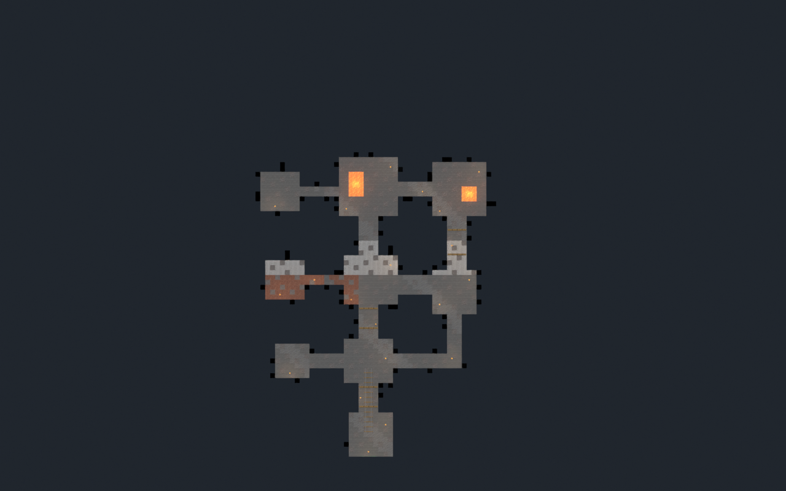
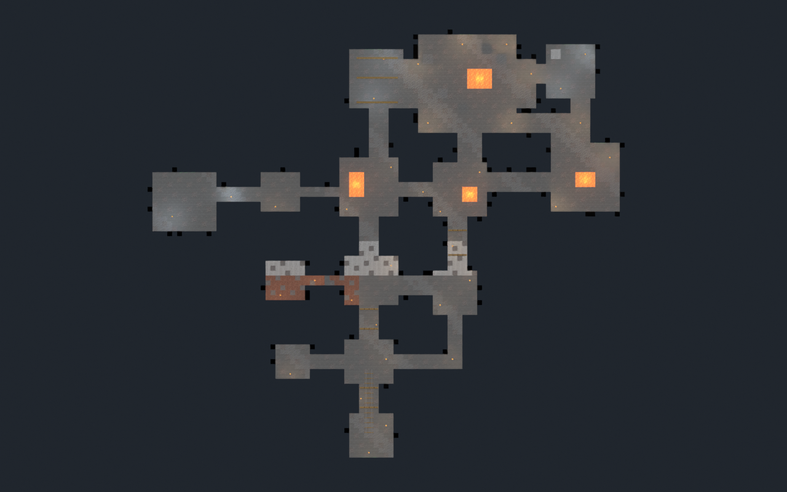

# Evidencias de fase 5

Comparación con idéntica cámara ortográfica, techos ocultos únicamente para la
vista técnica (no se ocultan en el juego):

| Mina anterior | Mina ampliada |
|---|---|
|  |  |

[Caverna en Blender](blender_cavern.png) · [Caverna en Rust](runtime_cavern.png)

Capturas del motor real:

- [Aldea](runtime_surface.png) y [menú de inicio](runtime_start_menu.png).
- [Salida sin diamantes](runtime_need_diamonds.png), [lava](runtime_lava.png),
  [pausa](runtime_pause.png) y [alerta de tiempo](runtime_low_time.png).
- [Victoria](runtime_victory.png), [derrota](runtime_defeat.png) y
  [regreso a la aldea](runtime_return.png).

Informes reproducibles:

- [Expansión](expansion.json), [preparación de bloques](preparation.json) y
  [apertura Blender/reimportación GLB](asset-validation.json).
- [Smoke gráfico/audio](runtime-validation.json): contexto OpenGL y dispositivo
  de audio reales, eventos nativos y presets de posición/tiempo. Volumen cero.
- [Recorridos simulados](balance.json): FPS y minería reales, rutas conocidas;
  no equivale a jugabilidad manual.
- [Cargo](cargo-verification.json), [regresiones](regression.json),
  [formato y protección](final-verification.json).
- [Inventario SHA-256 anterior](protected-sources.json) y
  [verificación final](protected-verification.json).

Ver [documentación completa](../../../minigames/minecraft-phase5.md).
