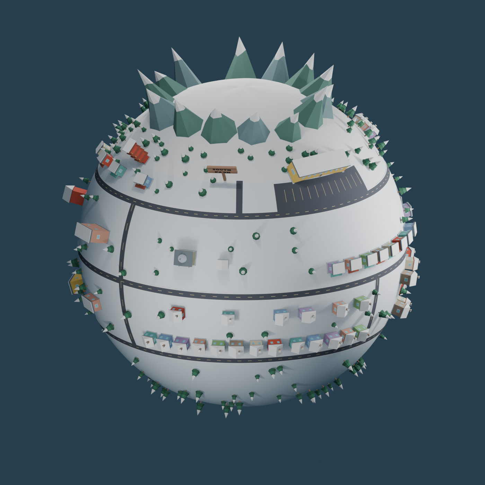
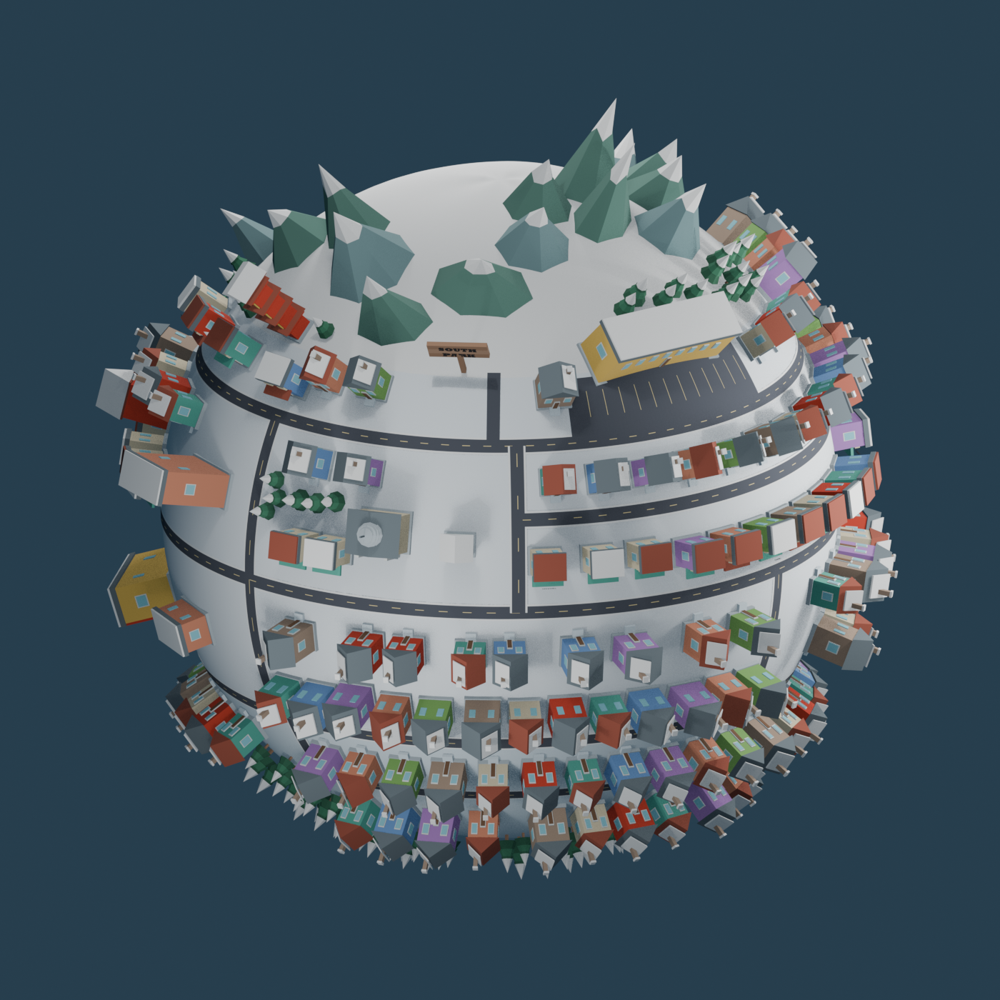

# South Park: comparación entre v1 y v2

Se refinó `assets/models/planets/southpark/southpark_planet.blend`; no se reconstruyó el planeta. La esfera conserva exactamente sus vértices y caras, y las mallas originales de las calles también permanecen intactas. Los 71 objetos de edificios originales se conservaron y modificaron en su sitio.

| Medida | V1 | V2 |
| --- | ---: | ---: |
| Edificios | 71 | **160** |
| Casas | 38 | 118 |
| Comercios, incluido restaurante | 25 | 34 |
| Edificios públicos e hitos | 8 | 8 |
| Pinos | 220 | 220 |
| Montañas | 14 | 14 |
| Objetos del planeta, incluidas raíz y agrupador del cartel | 337 | 439 |
| Objetos de malla | 335 | 437 |
| Mallas únicas utilizadas | 86 | 218 |
| Triángulos, contando instancias | 55 214 | **80 354** |
| Materiales utilizados | 28 | 28 |

## Comparación visual

Las dos vistas generales conservan cámara, escala ortográfica e iluminación de presentación para facilitar la comparación:

| Antes | Después |
| --- | --- |
|  |  |

Otras vistas: [frontal](southpark_v02_front.png), [trasera](southpark_v02_back.png), [este](southpark_v02_side.png), [oeste](southpark_v02_west.png), [superior](southpark_v02_top.png) y [escuela](southpark_v02_school_detail.png).

## Cambios de escala y apariencia

- Las casas originales aumentan aproximadamente **1.9 veces su altura nominal**. En el noreste el incremento visual es mayor porque antes se usaba escala 0.8. La huella nominal se amplía alrededor de 1.12–1.27 en anchura y 1.23–1.40 en profundidad según espacio disponible; no se aplicó un único escalado uniforme. Las casas nuevas tienen una altura nominal de 1.78 veces la plantilla de v1.
- Hitos como escuela, edificio público, cúpula, granero y pagoda reciben escalas específicas: alturas nominales entre 1.55 y 1.88 veces las anteriores y mayores huellas donde cabe. El edificio comercial grande conserva su estacionamiento.
- Todas las cimentaciones se recalculan sobre la esfera existente. Su base se asienta aproximadamente 0.01 unidades en la superficie; no se elevó la esfera ni se usaron plataformas planas gigantes.
- Se reduce la cobertura blanca de los tejados residenciales a placas de nieve. Se ven mejor los tejados marrones, grises y rojizos y se intensifican algunos colores compartidos de fachadas.
- South Park Elementary conserva el cuerpo amarillo y rojo y recibe un rótulo legible. El edificio cívico con cúpula, la pagoda, el granero y el gran edificio con estacionamiento mantienen su carácter. Las señales de comercios secundarios son genéricas: no identifican locales famosos que no se puedan confirmar.
- El cartel de madera y sus letras tridimensionales se conservaron.

## Densidad, carreteras y paisaje

Se añadieron **89 construcciones** como relleno organizado de barrios centrales, orientales, occidentales y de la franja sur, a ambos lados del ecuador. Las parcelas candidatas se filtran por separación entre huellas y carreteras; no se dispersan casas aleatoriamente por la esfera. Las adiciones reinterpretan la trama del mapa y no equivalen a 89 nuevos edificios nominalmente identificados. Sigue sin ser posible certificar un porcentaje exacto de cobertura del 80 % a partir de la imagen.

Se conservó la red vial inicial y se agregaron seis tramos secundarios que conectan bloques y la ampliación residencial sur. Las carreteras continúan siguiendo la curvatura. Las cotas distintas de las capas evitan superponer caras a la misma altura en intersecciones.

Las 14 montañas se distribuyen en una **cordillera abierta y ramificada**, con latitudes, alturas y anchuras variables, en vez de una corona regular de picos. Una ladera se separó del barrio noreste tras detectar un posible contacto. Se mantiene la región de fondo del mapa, con zonas naturales sin cubrir toda la esfera de montañas.

Los 220 pinos se agrupan en bosques y parques. Su escala actual está entre 1.10 y 1.40 respecto de la plantilla, frente a 0.62–1.04 en v1. Conservan una sola malla compartida. Se comprobaron distancias a carreteras, edificios, estacionamiento, lago y cartel; en bosques se permite una ligera proximidad entre copas.

## Verificación y pendientes

- Esfera intacta comprobada por SHA-256 de vértices y caras; red vial original conservada.
- Los 160 edificios mantienen orientación radial. No se detectaron solapamientos entre sus huellas ni contactos de cajas conservadoras entre montañas y edificios.
- Las cimentaciones inferiores quedan entre -0.009994 y -0.009669 unidades respecto de la superficie: un asiento ligero sin huecos de apoyo.
- Pruebas temporales de traslado, escala y rotación de la raíz satisfactorias, restauradas al terminar. Toda la geometría pertenece a su jerarquía.
- `SouthPark_SnowFX` sigue vacía. No hay partículas, órbitas ni animación. No se exportó a un motor.

Faltan fidelidad arquitectónica fina, confirmación de la identidad de edificios ambiguos y revisión manual de detalles y accesos. No se asignaron identidades de comisaría u hospital sin evidencia suficiente en la referencia. Hay zonas naturales abiertas, especialmente hacia los polos y alrededor del lago, para conservar el contraste entre ciudad y paisaje.

Antes de integrar en el juego: medir rendimiento en la plataforma elegida, agrupar por material cuando corresponda, separar cimentación y fachada si se quiere recuperar más instanciación de viviendas, y preparar colisiones y niveles de detalle. Los 28 materiales se reutilizan, pero 437 objetos de malla todavía pueden implicar muchas llamadas de dibujo. La ampliación es una fuente editable, no una garantía de rendimiento final.

La copia de v1 se conserva en `backups/southpark_before_iteration02.blend`, fuera de la carpeta principal del modelo y excluida de Git. No se modificaron otros planetas ni se hicieron commits o push.
