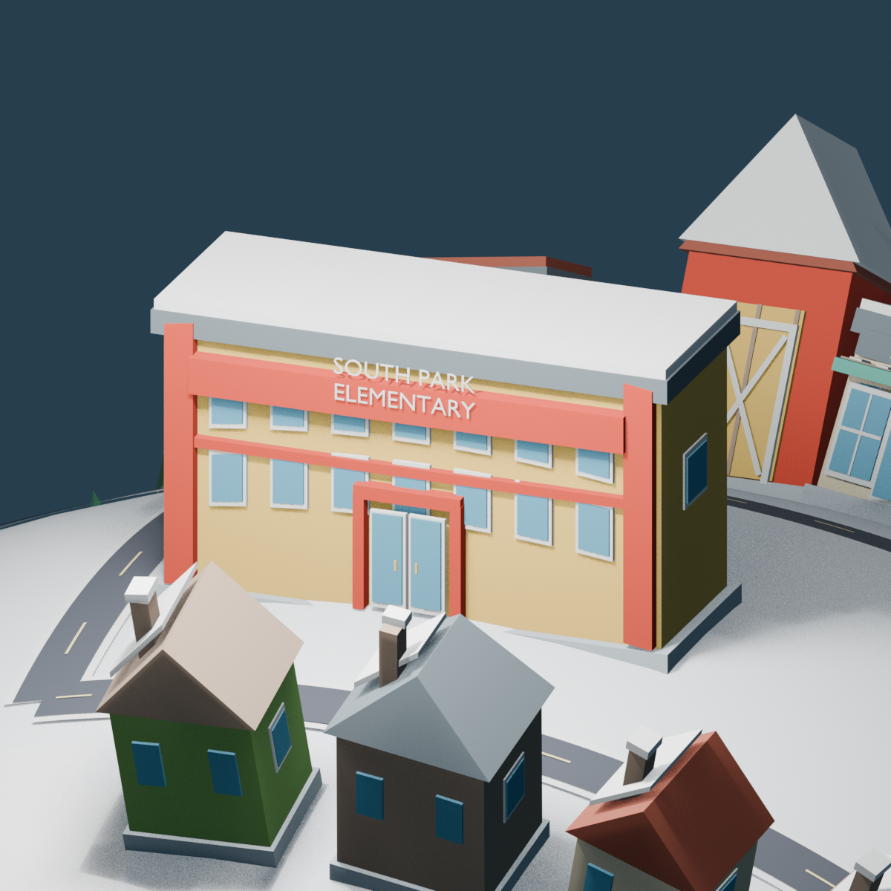
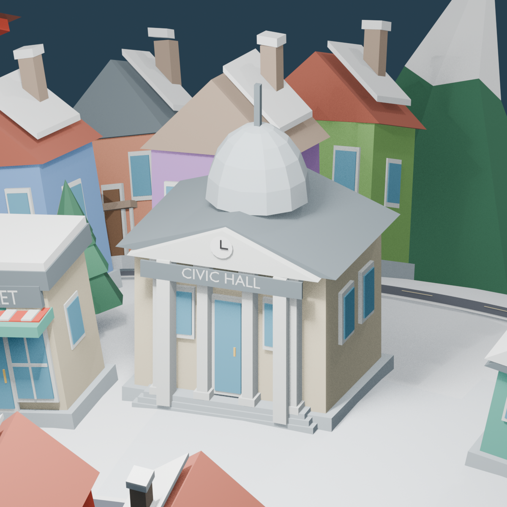

# South Park: identidad visual, iteración 3

Se refinó el archivo principal existente sin reconstruir la esfera, sustituir las carreteras ni reducir los barrios. Los **160 edificios de v2 permanecen**. La copia previa está en `backups/southpark_before_iteration03.blend`, fuera de la carpeta del modelo y excluida de Git.

## Cambios principales

- **South Park Elementary:** entrada doble, bandas rojas entre hileras de ventanas, fascia azul de cubierta y ventanas más definidas. Se mantiene el rótulo de dos líneas y la escala mayor que las casas.
- **Edificio cívico con cúpula:** pórtico con cuatro columnas, escalones, reloj, entrada, ventanas y cúpula curva de baja resolución en lugar de los cinco conos provisionales. La referencia permite distinguir el edificio con cúpula, pero no se certifica su identidad como ayuntamiento. `CIVIC HALL` es un rótulo descriptivo.
- **Zona comercial:** 34 escaparates con tres kits compartidos, puertas acristaladas, toldos y letreros genéricos. Se despejaron los escaparates al subir los toldos anteriores. El edificio grande con estacionamiento recibe una galería y el rótulo descriptivo `MALL`. No se atribuyen nombres de tiendas canónicas ilegibles.
- **Pagoda y granero:** molduras amarillas y detalles de fachada de la pagoda roja; puertas y riostras cruzadas del granero. Se conservan sus ubicaciones.
- **Vecindarios:** ocho familias de tejado con pendientes, faldones y colores moderadamente variados; cuatro kits reutilizados en 24 casas de esquina. Los barrios central, oriental, occidental, noreste y la ampliación sur conservan densidad. Se hicieron 29 ajustes de implantación de alrededor de un píxel del mapa y un giro de aproximadamente un grado, comprobando espacio y recalculando apoyos.
- **Montañas y nieve:** se conserva la cordillera abierta de v2, con picos ligeramente menos simétricos, laderas más verdes oscuras o grisáceas y nieve clara. La esfera solo cambia sutilmente la asignación de sus materiales de nieve; sus vértices y caras son idénticos.
- **Pinos:** 220 árboles repartidos como en v2, ahora con tres variantes de nieve que comparten geometría por grupos. Se apartaron ligeramente dos del borde de calzada; no se detectan contactos importantes con edificios o carreteras.
- **Cartel:** geometría, poste, proporciones y texto `SOUTH PARK` conservados. Ambas caras se leen correctamente. Las letras ya son malla; el generador conserva sus palabras y parámetros para editar o regenerar una copia.

## Cantidades y verificación

| Medida del planeta | V2 | V3 |
| --- | ---: | ---: |
| Edificios | 160 | 160 |
| Objetos, incluyendo raíz y agrupador del cartel | 439 | 496 |
| Objetos de malla | 437 | 494 |
| Mallas únicas utilizadas | 218 | 226 |
| Triángulos, contando instancias | 80 354 | 98 328 |
| Materiales compartidos | 28 | 28 |

Geometría de esfera y carreteras conservada por firmas de vértices y caras. Todas las construcciones mantienen orientación radial. Las cimentaciones conservan un asiento de aproximadamente 0.01 unidades, sin edificios flotantes. No se detectaron solapamientos de huellas entre edificios. Las pruebas temporales de traslado, escala y rotación de `SouthPark_Planet_ROOT` funcionaron y se restauraron. Toda la geometría sigue en su jerarquía.

Las [mediciones completas](southpark_iteration03_validation.json) y el [inventario](southpark_iteration03_inventory.json) permiten revisar el alcance de estas pruebas. Son comprobaciones geométricas conservadoras; queda pendiente la revisión de colisiones del juego en el motor que se elija.

## Capturas

[General](southpark_v03_three_quarter.png) · [frontal](southpark_v03_front.png) · [trasera](southpark_v03_back.png) · [este](southpark_v03_east.png) · [oeste](southpark_v03_west.png) · [superior](southpark_v03_top.png).

| Escuela | Edificio cívico |
| --- | --- |
|  |  |

Más acercamientos: [comercios](southpark_v03_commercial_detail.png), [pagoda](southpark_v03_pagoda_detail.png), [cartel](southpark_v03_sign_detail.png).

## Pendientes

Confirmar la identidad exacta de edificios ambiguos con una referencia más legible; no se creó ni se etiquetó una comisaría u hospital sin evidencia suficiente. La reconstrucción sigue siendo una interpretación caricaturesca del mapa, no una réplica arquitectónica ni una cobertura del 80 % certificada por un recuento exacto.

Antes de integrar: medir rendimiento, preparar colisiones y niveles de detalle y evaluar agrupaciones por material. Los kits compartidos limitan mallas únicas, pero 494 objetos de malla pueden implicar muchas llamadas de dibujo. No se realizaron optimizaciones destructivas generales, partículas, órbitas, navegación ni exportación final. Minecraft y las demás franquicias no se modificaron. No se hicieron commits ni push.
